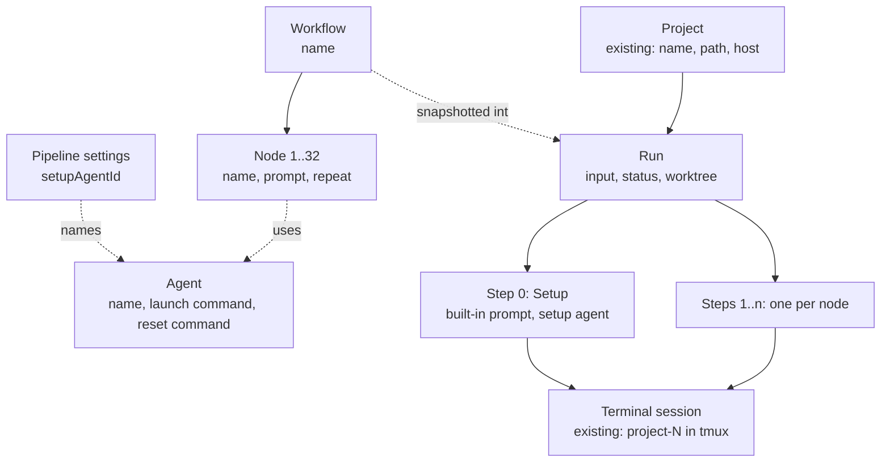
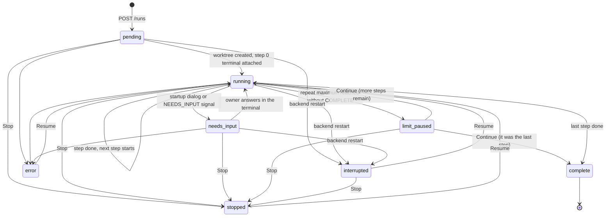
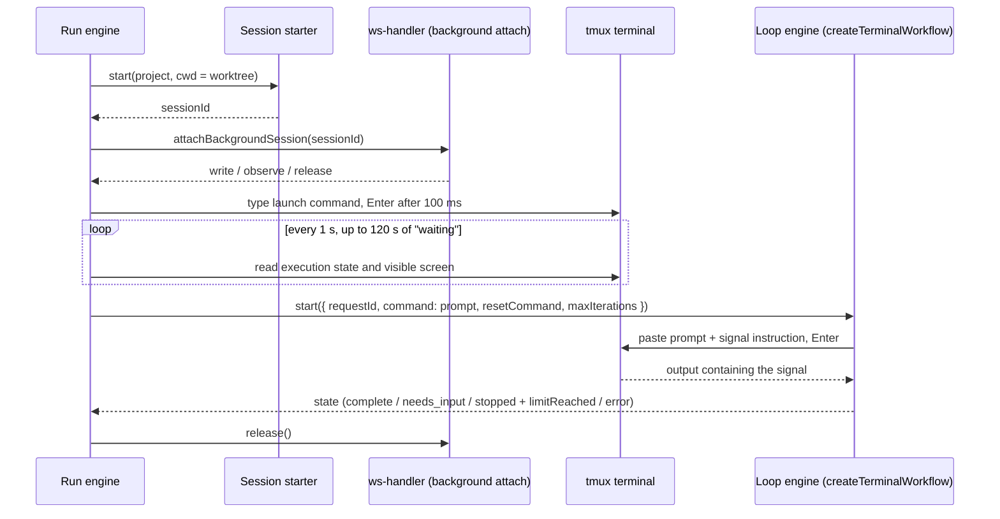

# Workflow Pipelines — Feature Specification

**Version:** 1.0
**Date:** 2026-11-13
**Status:** Draft

## 1. Overview

CodeDeck's terminal workflow is a proof of concept: one command plus one reset command, repeated in a
terminal where an agent is already running, with state held only in backend memory
(`server/terminal-workflow.js`). This feature develops it into configurable **workflow pipelines**.

The owner defines **agents** (how to launch an agent CLI) and **workflows** (an ordered line of
**nodes**, each a prompt handed to one agent) in Settings, then triggers a **run** of a workflow on a
project. For each run CodeDeck:

1. creates a dedicated git worktree for the run,
2. prepares it with an automated **Setup** step performed by a small-model agent,
3. runs each node in its own terminal tab inside that worktree — launching the node's agent CLI,
   submitting the prompt, and waiting for the agent's completion signal,
4. removes the worktree when the run completes, provided nothing in it is uncommitted.

The existing loop engine (`createTerminalWorkflow`) becomes the per-step building block; the pipeline
is a layer above it. The existing per-terminal **Workflow** bar is unchanged and remains the way to
loop one command in a terminal that is already open.

### 1.1 Decisions this spec encodes

| Topic | Decision |
|---|---|
| Where a node runs | Its own new terminal tab in the project, with the node's agent CLI launched in it |
| Agent | Named entry: name + interactive launch command written by the owner (it owns model, effort and permission flags) + reset command |
| Node | Name + agent + prompt text (may contain `{input}`) + repeat mode |
| Repeat | `once`, or `until_complete` with a maximum pass count; a repeat clears context with the agent's reset command and re-submits the same prompt in the same terminal |
| Workflow shape | Straight line. No branching, no jumping back, no repeating a group of nodes |
| Pass limit | A repeating node that reaches its maximum without COMPLETE pauses the run; the owner chooses Continue or Stop |
| Persistence | Runs are stored in SQLite. A backend restart marks an unfinished run `interrupted` |
| Resume | Manual, on any unfinished run (`interrupted`, `stopped`, `error`): re-runs the current step in a fresh tab and carries on |
| Worktree | Every run works in its own git worktree. There is no switch to turn this off |
| Worktree setup | Automated by a small LLM: a built-in Setup step run by the owner's chosen setup agent |
| Cleanup | On completion the worktree folder is removed only if nothing in it is uncommitted. The branch is always kept |
| Settings | The modal is widened and split into tabs; one tab is Workflows |

### 1.2 Out of scope for this version

- Remote projects and projects that are not the top level of a git working tree (§8.1).
- Branching, back-edges, group repeats, parallel nodes.
- Merging or deleting the run's branch.
- Automatic recovery of a run after a backend restart by reading the terminal screen.
- Agent CLIs without a screen profile in `server/agent-profiles/` (§8.4).
- Naming a node's tab after the node, pruning run history, limiting concurrent runs per project.

## 2. Domain Hierarchy



A run owns a **definition snapshot** taken at start, so later edits or deletions of the workflow,
its agents or the setup agent never change a run in flight, and history shows what actually ran.

## 3. Feature Toggle

None. Workflow pipelines are always available. A run cannot start until a setup agent is chosen
(§8.1); that is a precondition, not a toggle.

## 4. Entities

All rows are validated **per field** when written and again when read back from SQLite. A row that
fails a read guard makes the operation throw, naming the table, row id and field (never a command's
or prompt's content). Each store module creates its own table with `CREATE TABLE IF NOT EXISTS`,
following `server/terminal-waiting-store.js`.

Shared text rule **single-line**: no character in `[\x00-\x1f\x7f]`. Shared text rule **multi-line**:
no character in `[\x00-\x08\x0b-\x1f\x7f]` (tab and line feed allowed) — the class the engine already
applies to its command (`server/terminal-workflow.js:19-20`).

### 4.1 Agent — table `pipeline_agents`

| Field | Type | Constraints | Default |
|---|---|---|---|
| `id` | TEXT PK | UUID v4, server-generated | — |
| `name` | TEXT | 1–64 chars after trim, single-line, unique case-insensitively | — |
| `launch_command` | TEXT | 1–2048 chars, non-blank, single-line | — |
| `reset_command` | TEXT | 1–256 chars, non-blank, single-line | UI pre-fills `/clear` |
| `revision` | INTEGER | ≥ 1, incremented on every update | 1 |
| `created_at`, `updated_at` | TEXT | ISO-8601 UTC | now |

The launch command is the interactive command for the CLI, e.g.
`codex --model gpt-6-sol -c model_reasoning_effort="high"`. CodeDeck does not parse it.

### 4.2 Workflow — table `pipeline_workflows`

| Field | Type | Constraints | Default |
|---|---|---|---|
| `id` | TEXT PK | UUID v4 | — |
| `name` | TEXT | 1–64 chars after trim, single-line, unique case-insensitively | — |
| `nodes` | TEXT (JSON array) | 1–32 nodes, order is execution order | — |
| `revision` | INTEGER | ≥ 1 | 1 |
| `created_at`, `updated_at` | TEXT | ISO-8601 UTC | now |

**Node** (element of `nodes`); unknown fields are rejected:

| Field | Type | Constraints |
|---|---|---|
| `name` | string | 1–64 chars after trim, single-line, unique within the workflow case-insensitively |
| `agentId` | string | UUID of an existing agent |
| `prompt` | string | 1–8192 chars, non-blank, multi-line rule. `{input}` may appear zero or more times |
| `repeat` | object | `{ "mode": "once" }` or `{ "mode": "until_complete", "max": 1–100 }`. `max` is forbidden for `once` and required for `until_complete` |

### 4.3 Pipeline settings — table `pipeline_settings` (single row, `id = 1`)

| Field | Type | Constraints | Default |
|---|---|---|---|
| `setup_agent_id` | TEXT | null, or UUID of an existing agent | null |
| `revision` | INTEGER | ≥ 1 | 1 |

### 4.4 Run — table `pipeline_runs`

| Field | Type | Constraints |
|---|---|---|
| `id` | TEXT PK | UUID v4 |
| `request_id` | TEXT UNIQUE | `^[\w-]{1,128}$`, client-generated idempotency key |
| `workflow_id` | TEXT | UUID (the workflow may later be deleted; the snapshot is authoritative) |
| `project` | TEXT | project name at start |
| `input` | TEXT | 0–4096 chars, single-line |
| `status` | TEXT | run status enum (§5.1) |
| `stop_reason` | TEXT | null, `user`, or `terminal`; non-null exactly when `status = stopped` |
| `current_step_index` | INTEGER | 0 ≤ index < number of steps |
| `error` | TEXT | non-null exactly when `status = error`; ≤ 2000 chars |
| `definition` | TEXT (JSON) | definition snapshot (below), re-validated on read |
| `steps` | TEXT (JSON array) | one progress record per step; length equals the snapshot's step count |
| `home_path` | TEXT | absolute path of the home repository |
| `worktree_path` | TEXT | absolute path chosen at start |
| `worktree_branch` | TEXT | branch name chosen at start |
| `base_commit` | TEXT | null until the worktree is created, then a 40-hex commit id |
| `worktree_state` | TEXT | worktree state enum (§5.3) |
| `worktree_detail` | TEXT | null, or ≤ 2000 chars explaining a blocked removal |
| `created_at`, `updated_at` | TEXT | ISO-8601 UTC |
| `finished_at` | TEXT | null until the status is `complete`, `stopped` or `error` |

**Definition snapshot:**

```json
{
  "workflowId": "…", "workflowName": "Feature", "workflowRevision": 3,
  "steps": [
    { "kind": "setup", "name": "Setup", "prompt": "<built-in setup prompt, §8.5>",
      "repeat": { "mode": "until_complete", "max": 3 },
      "agent": { "id": "…", "name": "haiku", "launchCommand": "…", "resetCommand": "/clear" } },
    { "kind": "node", "name": "Develop", "prompt": "/feature-dev docs/todos/x.md",
      "repeat": { "mode": "until_complete", "max": 20 },
      "agent": { "id": "…", "name": "codex-sol-high", "launchCommand": "…", "resetCommand": "/clear" } }
  ]
}
```

Node prompts in the snapshot are already composed: every `{input}` is replaced by the run's input in
a single pass (`replaceAll`), so an input containing `{input}` is not expanded again.

**Step progress record:**

| Field | Type | Constraints |
|---|---|---|
| `status` | string | step status enum (§5.2) |
| `sessionId` | string or null | `^<project>-\d+$` once a terminal exists |
| `priorSessionIds` | string[] | terminals of earlier attempts, oldest first |
| `attempt` | integer | ≥ 0; incremented each time the step is (re)started |
| `iteration` | integer | ≥ 0; passes made in the current attempt |
| `detail` | string or null | ≤ 2000 chars, e.g. the last readiness reason |
| `startedAt`, `finishedAt` | string or null | ISO-8601 UTC |

## 5. Enums

### 5.1 Run status

| Value | Meaning |
|---|---|
| `pending` | Accepted; the worktree is being created or the first terminal is being opened |
| `running` | A step is launching or working |
| `needs_input` | The current step's agent is waiting for the owner (a startup dialog or a NEEDS_INPUT signal) |
| `limit_paused` | A repeating step reached its maximum pass count without COMPLETE; waiting for Continue or Stop |
| `interrupted` | The backend restarted while the run was `pending`, `running` or `needs_input` |
| `stopped` | Stopped by the owner (`stop_reason = user`) or from the terminal's own bar / loss of the attachment (`stop_reason = terminal`) |
| `error` | The run could not continue; `error` says why |
| `complete` | Every step finished |



`limit_paused` survives a backend restart unchanged: nothing in memory is needed to act on it.

### 5.2 Step status

`pending`, `launching`, `running`, `needs_input`, `complete`, `limit_reached`, `failed`, `stopped`,
`interrupted`. A step is finished when it is `complete` or `limit_reached`.

### 5.3 Worktree state

| Value | Meaning |
|---|---|
| `not_created` | The worktree does not exist yet |
| `present` | The worktree exists on disk |
| `removed` | Cleanup removed it (or there was nothing to remove) |
| `removal_blocked` | Git refused to remove it; `worktree_detail` says why |

## 6. API Endpoints

One router, `server/routes/pipelines.js`, created by `createPipelinesRouter(deps)` and mounted with
`app.use(...)` like `server/routes/terminal-waiting.js`. Base path `/api/pipelines`. The prefix is
added to the list that bypasses the global JSON parser in `server/index.js`; the router owns its own
`express.json({ limit: '512kb' })`, a per-request trace id returned as `X-Trace-Id`, a catch-all 404,
and one RFC 9457 error handler for every route under the base path.

| Method | Path | Action | Success |
|---|---|---|---|
| GET | `/agents` | List agents | 200 |
| POST | `/agents` | Create an agent | 201 |
| GET | `/agents/:id` | Get an agent | 200 |
| PUT | `/agents/:id` | Replace an agent (requires `revision`) | 200 |
| DELETE | `/agents/:id` | Delete an agent | 204 |
| GET | `/workflows` | List workflows | 200 |
| POST | `/workflows` | Create a workflow | 201 |
| GET | `/workflows/:id` | Get a workflow | 200 |
| PUT | `/workflows/:id` | Replace a workflow (requires `revision`) | 200 |
| DELETE | `/workflows/:id` | Delete a workflow | 204 |
| GET | `/settings` | Get pipeline settings | 200 |
| PUT | `/settings` | Set the setup agent (requires `revision`) | 200 |
| GET | `/preflight?project=<name>` | Report whether a run can start on the project | 200 |
| GET | `/runs` | List runs | 200 |
| POST | `/runs` | Start a run | 201 (200 on replay) |
| GET | `/runs/:id` | Get a run | 200 |
| POST | `/runs/:id/stop` | Stop a run | 200 |
| POST | `/runs/:id/resume` | Resume an unfinished run | 200 |
| POST | `/runs/:id/continue` | Leave a pass-limit pause | 200 |
| POST | `/runs/:id/cleanup` | Remove (or retry removing) the run's worktree | 200 |

### 6.1 Collections

Zero-based `page` (default 0, max 100000), `size` (default 20, max 100), `sort=field,asc|desc`, with
`id` appended as the stable tiebreaker. Unknown query fields, unknown sort fields and out-of-range
values return 400 with field errors. The response is `{ data, page: { currentPage, size,
totalElements, totalPages, hasNextPage } }`.

| Collection | Exact-match filters | Sort fields | Default sort |
|---|---|---|---|
| `/agents` | `name` | `name`, `updatedAt` | `name,asc` |
| `/workflows` | `name` | `name`, `updatedAt` | `name,asc` |
| `/runs` | `status`, `project`, `workflowId`, `open` (`true`/`false`) | `createdAt`, `updatedAt`, `status` | `createdAt,desc` |

A run is **open** while it still needs or allows an owner action: any status other than `complete`
with `worktree_state` in `not_created`, `present` or `removal_blocked`, or `complete` with
`worktree_state = removal_blocked`.

### 6.2 Errors

Every failure is `application/problem+json` with `type`, `title`, `status`, `detail`, `timestamp`,
`error`, `message`, `path`, `traceId`; every 400 also carries `errors: [{ field, message }]` listing
all failed fields at once. A 500 never exposes its cause; the cause is logged with the trace id.
Commands and prompts are never logged.

| Condition | Status |
|---|---|
| Validation failure, unknown body field, malformed JSON | 400 |
| Body over 512 KB | 413 |
| Unknown agent, workflow, run, or (for `/preflight` and `POST /runs`) project | 404 |
| Duplicate agent or workflow name | 409 |
| `revision` does not match the stored revision | 409 |
| Deleting an agent used by a workflow, or the current setup agent | 409 |
| `POST /runs` with a `requestId` already used with a different body | 409 |
| `POST /runs` when a start precondition fails (§8.1) | 409 |
| An action not allowed in the run's current state (§8.8) | 409 |

No endpoint makes an outbound network call (git and tmux run locally; remote projects are refused),
so the circuit-breaker rule of the global API standard does not apply.

## 7. Request/Response Schemas

**Agent** — `POST /agents` body is `{ name, launchCommand, resetCommand }`; `PUT` adds `revision`.

```json
{ "id": "6f1c…", "name": "codex-sol-high",
  "launchCommand": "codex --model gpt-6-sol -c model_reasoning_effort=\"high\"",
  "resetCommand": "/clear", "revision": 1,
  "createdAt": "2026-11-13T11:00:00.000Z", "updatedAt": "2026-11-13T11:00:00.000Z" }
```

**Workflow** — `POST /workflows` body is `{ name, nodes }`; `PUT` adds `revision`.

```json
{ "id": "a2d0…", "name": "Feature", "revision": 3,
  "nodes": [
    { "name": "Develop", "agentId": "6f1c…", "prompt": "/feature-dev {input}",
      "repeat": { "mode": "until_complete", "max": 20 } },
    { "name": "Test", "agentId": "9b77…", "prompt": "/feature-test {input}",
      "repeat": { "mode": "once" } }
  ],
  "createdAt": "…", "updatedAt": "…" }
```

**Settings** — `PUT /settings` body is `{ setupAgentId, revision }`.

```json
{ "setupAgentId": "c410…", "revision": 2 }
```

**Preflight**

```json
{ "project": "codedeck", "eligible": false,
  "reasons": [ { "code": "setup_agent_missing", "message": "Choose a setup agent in Settings → Workflows." } ],
  "branch": "main", "head": "15b9b47…", "dirty": true }
```

`reasons[].code` is one of `project_remote`, `not_git_toplevel`, `setup_agent_missing`. `branch` is
null on a detached HEAD; `branch`, `head` and `dirty` are null when the project is not eligible for a
git reason. `dirty` is a warning, never a reason.

**Start a run** — `POST /runs`

```json
{ "requestId": "run-3f2a9c", "workflowId": "a2d0…", "project": "codedeck",
  "input": "docs/todos/2026-11-13-134947-workflow-pipelines.md" }
```

**Run view** (returned by every run endpoint)

```json
{ "id": "0d9e4b1a-…", "requestId": "run-3f2a9c", "workflowId": "a2d0…", "workflowName": "Feature",
  "project": "codedeck", "input": "docs/todos/…", "status": "running", "stopReason": null,
  "error": null, "currentStepIndex": 1,
  "steps": [
    { "index": 0, "kind": "setup", "name": "Setup", "agentName": "haiku",
      "repeat": { "mode": "until_complete", "max": 3 }, "status": "complete",
      "sessionId": "codedeck-7", "priorSessionIds": [], "attempt": 1, "iteration": 1,
      "detail": null, "startedAt": "…", "finishedAt": "…" },
    { "index": 1, "kind": "node", "name": "Develop", "agentName": "codex-sol-high",
      "repeat": { "mode": "until_complete", "max": 20 }, "status": "running",
      "sessionId": "codedeck-8", "priorSessionIds": [], "attempt": 1, "iteration": 4,
      "detail": null, "startedAt": "…", "finishedAt": null }
  ],
  "worktree": { "path": "/Users/me/git/worktrees/codedeck-feature-0d9e4b1a",
    "branch": "workflow/feature-0d9e4b1a", "baseCommit": "15b9b47…", "state": "present", "detail": null },
  "actions": { "stop": true, "resume": false, "continue": false, "cleanup": false },
  "createdAt": "…", "updatedAt": "…", "finishedAt": null }
```

`actions` is computed by the backend from §8.8 so the client never decides which buttons are valid.
Launch commands, reset commands and prompts are not part of the run view.

**Problem document**

```json
{ "type": "about:blank", "title": "Validation Error", "status": 400,
  "detail": "One or more fields failed validation.", "error": "Validation Error",
  "message": "One or more fields failed validation.", "timestamp": "2026-11-13T11:00:00.000Z",
  "path": "/api/pipelines/workflows", "traceId": "4bf92f35-…",
  "errors": [ { "field": "nodes[1].repeat.max", "message": "Use a whole number from 1 to 100" } ] }
```

## 8. Behavioral Rules

### 8.1 Starting a run

`POST /runs` validates the body, then checks, in this order:

1. `requestId` replay: the same `requestId` with the same `workflowId`, `project` and `input` returns
   the existing run with 200; with a different body, 409.
2. The workflow and the project exist (404 otherwise).
3. The project is local — it has no `host`, or its `host` is `local`, the same test
   `server/host-runtime-resolver.js` applies (409 `project_remote`).
4. The project path is the top level of a git working tree: `git -C <path> rev-parse
   --show-toplevel` equals the real path of the project (409 `not_git_toplevel`).
5. A setup agent is chosen (409 `setup_agent_missing`).
6. `input` is non-empty when any node prompt contains `{input}` (400 on `input`).
7. Every composed node prompt is at most 16384 chars, the engine's command limit (400 on `input`).

It then stores the run as `pending` with its definition snapshot, chosen worktree path and branch,
`worktree_state = not_created`, and returns 201. Creating the worktree and everything after it
happens after the response. `GET /preflight` evaluates checks 3–5 and reports the checkout's branch,
HEAD and whether `git status --porcelain` is non-empty.

**Names.** With `shortId` = the first 8 hex characters of the run id and `slug` = the workflow name
lower-cased with every run of characters outside `[a-z0-9]` replaced by `-`, trimmed of `-`, cut to
32 chars:

- home repository = the parent directory of `git rev-parse --path-format=absolute --git-common-dir`
- worktree path = `<parent of home repository>/worktrees/<home repository folder name>-<slug>-<shortId>`
- branch = `workflow/<slug>-<shortId>`

When `slug` is empty the `<slug>-` part is omitted from both.

### 8.2 Worktree lifecycle

Implemented in `server/pipelines/run-worktree.js` with an injected `execFile` (argument arrays, no
shell), each call with an explicit timeout.

- **Create** (first engine action of a run whose `worktree_state` is `not_created`): record
  `git rev-parse HEAD` of the project checkout as `base_commit`, then run
  `git -C <home> worktree add <worktree_path> -b <branch> <base_commit>`. Success sets
  `worktree_state = present`. Failure sets the run to `error` with git's message.
- **Terminals** for every step are created with the worktree path as their working directory while
  keeping the project's `${project}-N` session id, so they are tabs of the project.
- **Cleanup** runs automatically when a run becomes `complete`, and on demand through
  `POST /runs/:id/cleanup`. It runs `git -C <home> worktree remove <worktree_path>` — never with
  `--force`. Verified behaviour of git this relies on: the command succeeds and discards ignored
  files when only ignored files remain; it exits non-zero with "contains modified or untracked
  files" when a tracked file is modified, a new file is staged, or an untracked file exists; it
  succeeds and keeps the branch when the worktree is clean but its commits are unmerged.
  - Success → `worktree_state = removed`.
  - Refusal → `worktree_state = removal_blocked`; `worktree_detail` holds git's message followed by up
    to 20 paths from `git status --porcelain` (paths only, never file contents). The run's status does
    not change.
  - For a run whose `worktree_state` is `not_created`, cleanup makes no git call and sets `removed`.
- The branch is never deleted or merged by CodeDeck.
- Cleanup does not close terminals. Terminals of the run stay open in a directory that no longer
  exists until the owner closes them.

### 8.3 Running one step



- A step always gets a **new** terminal. Repeats of a step reuse that step's terminal.
- The engine never advances inside the loop engine's `notify` call stack; each run's transitions are
  serialised on a promise chain.
- The loop-engine `requestId` for a step attempt is `run-<runId>-<stepIndex>-<attempt>`.
- When a step finishes, the engine releases its attachment. The tmux session and its tab stay.

### 8.4 Launch and readiness

The launch command is typed through the attachment followed by `\r` 100 ms later. The engine then
polls the runtime directly every second (not through the 2.5 s status cache) and classifies:

| Result | Condition | Effect |
|---|---|---|
| `ready` | execution reason `agent_prompt_idle` **and** the matched profile's `promptVisible(lines)` is true | start the loop engine |
| `needs_input` | execution reason `agent_needs_input` (trust or permission dialog) | run `needs_input`; the 120 s clock pauses; polling continues |
| `exited` | the foreground command was not a shell and is now a shell prompt | run `error`: "The launch command for agent <name> exited." |
| `closed` | the session entry is gone or not alive | run `error`: "The terminal closed while launching agent <name>." |
| `waiting` | anything else | keep polling |

After 120 s of accumulated `waiting` the run becomes `error`, naming the agent, the last execution
reason and the foreground command. There is no quiet-timer or other fallback: an agent CLI without a
screen profile, or a dialog the profile does not recognise, always ends in this error.

`promptVisible(lines)` is a new export on each profile in `server/agent-profiles/` because a profile
matched by its foreground command reports idle before its prompt is drawn.

### 8.5 The Setup step

Step 0 of every run. It uses the snapshot of the setup agent, `repeat = { until_complete, max 3 }`,
and this fixed prompt (with the two paths substituted):

```
You are preparing a fresh git worktree so that work can be built and tested in it.
Home checkout (read-only source of local files): <home_path>
Worktree (your current directory, the only place you may change): <worktree_path>

1. Work out how this project installs its dependencies (lock files, build files, README, agent
   instruction files) and install them in the worktree.
2. Find files in the home checkout that git ignores and that the project needs locally to build,
   test or run (for example .env.local, local.properties, service-account files). Copy each one to
   the same relative path and the same name in the worktree. Do not copy dependency or build output
   directories; install or build those in the worktree instead.
3. Never print, summarise or log the contents of a copied file. Copy with file operations only.
4. Do not create, modify or delete tracked files, do not commit, and change nothing in the home
   checkout.
5. Finish by running `git status --short` in the worktree. It must print nothing.

If you cannot tell what the project needs, or a step fails, report NEEDS_INPUT and say what is missing.
```

When the Setup step finishes, the engine runs `git status --porcelain` in the worktree. Any output
makes the run `error`: "Setup left uncommitted changes in the worktree", followed by up to 20 paths.

### 8.6 Repeat and the pass limit

`createTerminalWorkflow.start` accepts an optional `maxIterations` (integer 1–100). When a CONTINUE
signal arrives on pass number `maxIterations`, the loop engine finishes with status `stopped` and
`limitReached: true` instead of resetting. `snapshot()` gains `iteration` and `limitReached`. No new
status value is added, so the existing client and the browser's own `workflow_start` message (which
cannot carry `maxIterations`) behave as before.

| Step repeat | `maxIterations` | COMPLETE | Limit reached |
|---|---|---|---|
| `once` | 1 | step `complete`, advance | step `complete`, advance |
| `until_complete`, max N | N | step `complete`, advance | step `limit_reached`, run `limit_paused` |

From `limit_paused`, **Continue** advances to the next step (or completes the run when it was the
last step); **Stop** stops the run. The paused step is recorded as `limit_reached` either way.

### 8.7 Signals that end or pause a step

| Event | Run effect |
|---|---|
| Loop engine `needs_input` | run `needs_input`; an answer typed in the terminal returns it to `running` (existing engine behaviour) |
| Loop engine `error` | run `error` with the engine's message |
| Loop engine `stopped` without `limitReached`, not requested by the run engine | run `stopped`, `stop_reason = terminal` (Stop in the terminal's own bar, or the attachment exited) |
| The step's terminal is deleted or pruned | run `error`: "The terminal for step <name> was closed." |

Session delete (`server/routes/terminal-delete.js`) and session GC (`onPruned` in `server/index.js`)
each notify the run engine with the session id.

### 8.8 Owner actions

| Action | Allowed when | Effect | Otherwise |
|---|---|---|---|
| Stop | `pending`, `running`, `needs_input`, `limit_paused`, `interrupted` | run `stopped`, `stop_reason = user`; aborts the readiness poll and stops the loop engine; does **not** interrupt the agent | already `stopped` → 200 unchanged; `complete` or `error` → 409 |
| Resume | `interrupted`, `stopped`, `error`, with `worktree_state` `not_created` or `present` | the current step gets `attempt + 1`, its session id moves to `priorSessionIds`, and the run continues from that step in a fresh terminal (creating the worktree first when `not_created`) | 409 |
| Continue | `limit_paused` | §8.6 | 409 |
| Cleanup | status `complete`, `stopped`, `error` or `interrupted`, with `worktree_state` `not_created`, `present` or `removal_blocked` | §8.2 | 409 |

Resume returns 409 when `worktree_state` is `present` but the directory no longer exists. Resume does
not check whether the previous terminal's agent is still working; the client warns before resuming.

### 8.9 Restart

When the run store is constructed, every run in `pending`, `running` or `needs_input` becomes
`interrupted`, and its current step becomes `interrupted`. Nothing is re-attached automatically.

### 8.10 Background attachment

`server/ws-handler.js` changes:

- The block that lazily creates a session's loop engine (currently inside
  `registerSessionSocketHandlers`) is extracted into `ensureSessionWorkflow(entry, …)`, with `write`
  and `notify` unchanged, plus a call to each function in `entry.workflowObservers`. A browser that
  attaches later therefore gets the same engine and its `workflow_state`.
- A new export, `attachBackgroundSession(…)`, builds the same session entry and tmux attach client a
  browser attach builds, with no socket (`ws: null`, `wsAttached: false`). It handles the same three
  cases as a browser attach (no entry, live entry, dead recoverable entry), rejects a tombstoned
  session id, and returns `{ entry, workflow, write(data), observe(fn), release() }`.
- A hold counter, `entry.backgroundHolds`, is incremented on attach and checked in
  `detachTmuxClient`, so a browser that attaches and leaves while the agent is still launching does
  not kill the engine's attachment. `release()` decrements it and detaches when no browser is attached.
- The control model is untouched: engine writes go straight to the PTY as the loop engine's already
  do, and a browser claims control normally.

`createMobileSessionStarter(...).start` gains an optional, validated `cwd` (an absolute path) used in
place of `project.path`; its returned `cwd` reflects it.

### 8.11 Client

**Settings modal** (`client/src/components/SettingsPanel.jsx`)
- Width 880 px (max 90vw), fixed height 80vh, with a tab strip: **General** (default path, editor
  command, finish cooldown), **Session naming**, **Hosts**, **Workflows**.
- Every panel stays mounted and inactive panels are hidden, because the footer Save calls the naming
  panel's `save()` and its dirty state is local.
- The footer (Save / Revert, "unsaved changes") is shown on General and Session naming only. Hosts
  and Workflows save per item with their own toasts.
- Closing the modal with unsaved changes anywhere asks for confirmation.

**Workflows tab** (`client/src/components/pipelines/`)
- Agents: list with inline add, edit (name, launch command, reset command) and delete.
- Setup agent: a select over the agents, saved on change.
- Workflows: list with add, delete, and an editor for name and nodes — add, remove, move up/down,
  agent select, prompt textarea, repeat mode and maximum. Field errors come from the shared validator
  and from the API's `errors` array. Save sends `revision`; a 409 tells the owner the item changed
  and reloads it.
- Every mutation shows a success or failure toast; error text comes from the API's `message`.

**Running**
- A **Run workflow** button beside Session search in the terminal tab bar opens a dialog: workflow
  select, input field, the preflight result (ineligible reasons block Start; `dirty` shows the
  warning "Uncommitted changes in this checkout will not be in the run's worktree"), and Start.
- A **runs bar** above the tab bar lists the active project's open runs: workflow name, one chip per
  step with its status and pass `k/N`, the worktree branch, the error or blocked-cleanup detail, and
  the buttons the run's `actions` allow (Stop, Resume, Continue, Clean up worktree). Clicking a step
  chip activates that step's terminal tab. Resume asks for confirmation and names the previous
  terminal, warning that its agent may still be working.
- Run state is polled: `GET /api/pipelines/runs?open=true&size=100` every 2 s with the same in-flight
  guard as the session poll in `client/src/App.jsx`, and refetched after each action. Status
  transitions produce toasts.

**Tab adoption**
- The single-session `resumedSessionId` special case (`client/src/App.jsx`,
  `client/src/components/TerminalArea.jsx`) is generalised to `adoptSessions: [{ sessionId,
  activate }]`. A pure planner in `client/src/utils/terminalAdoption.js` decides which sessions need
  a tab; `TerminalArea` applies the result in one state update.
- App supplies the session-resume request (`activate: true`) and the step sessions of the active
  project's open runs that are alive. Only the first step of a run started in this browser activates;
  later steps open in the background so they do not take focus.

**Existing Workflow bar** — its status label shows "Pass limit reached" when the loop engine reports
`limitReached`.

**Sidebar** — a project row shows the number of its open runs.

### 8.12 Unchanged behaviour worth stating

- The per-terminal Workflow bar, its WebSocket messages and its control rules.
- Each step is an ordinary terminal: finished styling, waiting marks, session naming and the existing
  per-terminal completion notification apply to it as to any terminal. There is no run-level push
  notification.
- Agent conversations started in a worktree are recorded by each CLI under the worktree path, so
  Session search does not list them under the project.

## 9. Acceptance Criteria

**Definitions**
- Agents, workflows and settings can be created, read, updated and deleted through the API; each list
  returns the `data` + `page` envelope, sorts deterministically across a page boundary, and rejects
  unknown query and sort fields with 400.
- Every validation rule in §4 is enforced on write, returns all failed fields in one `errors` array,
  and is enforced again when rows are read back (a corrupted row makes the read throw).
- A stale `revision` returns 409; deleting an agent used by a workflow or chosen as setup agent
  returns 409; duplicate names return 409.

**Engine**
- With no browser attached, a session created for a step can be written to and its output observed,
  and a browser attaching later sees the same loop-engine state.
- A browser attaching and leaving during launch does not end the engine's attachment.
- `maxIterations` ends the loop engine with `limitReached` on the Nth CONTINUE; existing workflow
  tests still pass; the browser's `workflow_start` is unaffected.
- A run started through the API on a local git project creates its worktree and branch, runs Setup,
  runs every node in its own terminal inside the worktree in order, and reaches `complete`.
- A `once` step advances after one pass on either signal; an `until_complete` step advances on
  COMPLETE and pauses the run at its maximum; Continue and Stop behave as §8.6.
- NEEDS_INPUT and a startup dialog put the run in `needs_input`, and it returns to `running` when
  answered.
- Readiness never established within 120 s, a launch command that exits, a closed terminal, a failed
  `git worktree add`, and a Setup step that leaves uncommitted changes each put the run in `error`
  with the message in §8.
- Stop, Resume, Continue and Cleanup are accepted and refused exactly as §8.8, and `actions` in the
  run view matches.
- After the run store is rebuilt, `pending`, `running` and `needs_input` runs are `interrupted`;
  `limit_paused` runs are unchanged; Resume continues an interrupted run from its current step in a
  new terminal.
- A second `POST /runs` with the same `requestId` and body returns the same run with 200 and creates
  no second worktree; with a different body it returns 409.
- `POST /runs` is refused with 409 for a remote project, a project that is not a git top level, and
  when no setup agent is chosen.

**Worktree**
- On completion a clean worktree is removed and its branch still exists.
- A worktree with a modified, staged or untracked file is not removed: the run is `complete` with
  `worktree_state = removal_blocked` and the blocking paths in `worktree_detail`; after the owner
  resolves it, Cleanup succeeds.
- Ignored files alone do not block removal.
- `git worktree remove` is never invoked with `--force`, and no branch is deleted.

**Client**
- The settings modal shows four tabs; saving General and Session naming works as before; Hosts and
  Workflows are fully manageable with toasts for success and failure.
- The Run dialog blocks Start with the preflight reasons and shows the uncommitted-changes warning.
- Each step's terminal gets a tab within one poll without a reload or project switch; later steps do
  not take focus.
- The runs bar shows step progress and only the actions the backend allows.

## 10. Integration Context

None. Everything this feature touches — SQLite, git and tmux — runs on the same machine and inside
this repository's test infrastructure. Agent CLIs are external programs; tests replace them with a
stub script that draws a screen one of the existing profiles recognises
(`server/__tests__/fixtures/agent-screens`).

## 11. Known Limits

- Only CLIs with a screen profile (Claude, Codex, Cursor, agy, Muse) can run a step.
- Local projects whose path is the top level of a git working tree only.
- The worktree contains committed files only; an uncommitted todo or spec in the checkout is absent
  from it. The Run dialog warns; it does not block.
- Setup quality depends on the chosen model. A wrong or incomplete setup surfaces when a later step's
  build or tests fail. The setup agent's launch command must carry permission flags that let it
  install and copy.
- Stop does not interrupt the agent, and Resume can start a second agent while the first is still
  working in the old terminal.
- Completion relies on the agent printing the signal; that reliability is inherited from the engine.
- The launch command is typed before the shell prompt is confirmed, and input is not blocked during
  launch (startup dialogs need it), so a keystroke at that moment can garble the command.
- The backend's `node --watch` restarts on edits to four server files; that interrupts runs, which
  are then recoverable with Resume.
