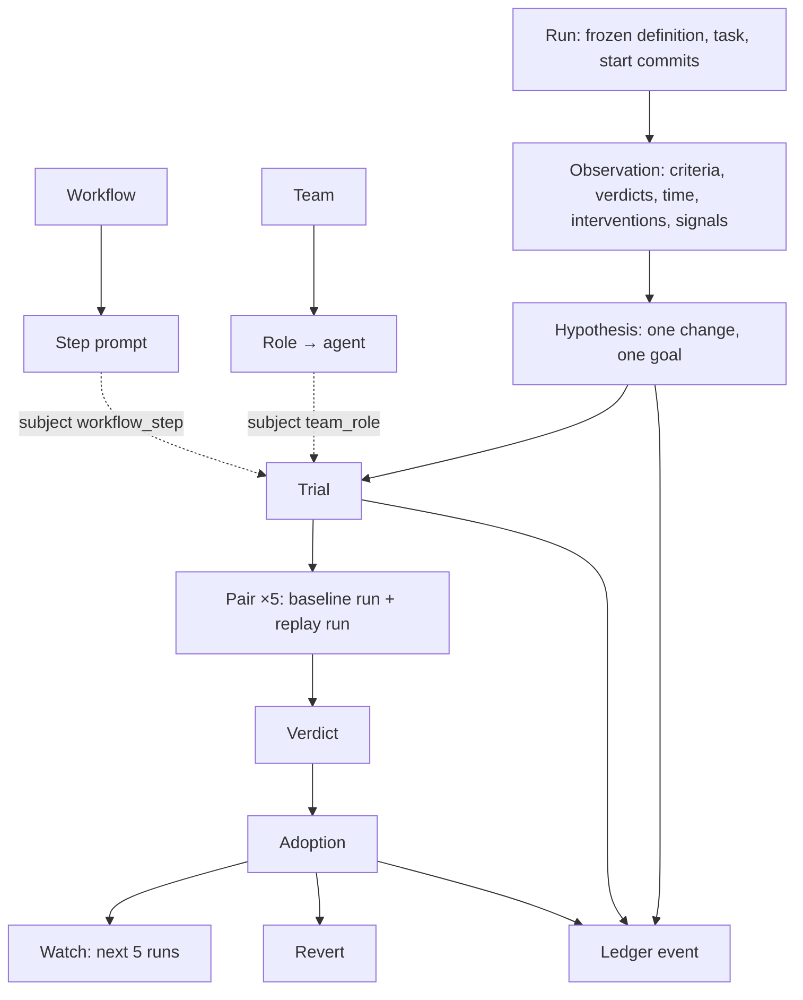
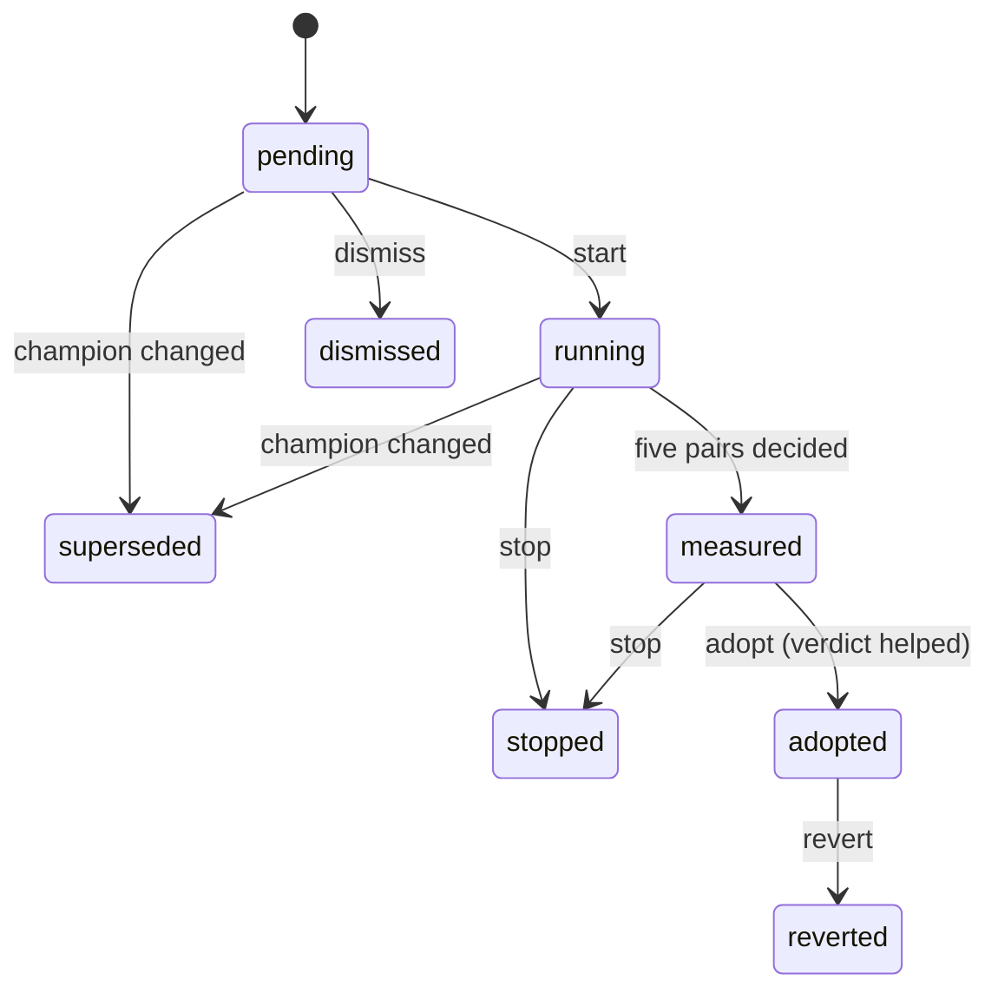
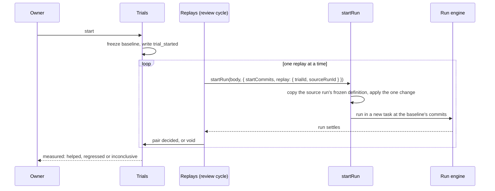

# Improvement Loop — Feature Specification

**Version:** 1.0
**Date:** 2026-11-21
**Status:** Draft

## 1. Overview

CodeDeck reviews finished workflow runs and proposes changes to workflow step prompts and to
team role assignments. The loop on `main` has not closed once. Between 19 and 21 November 2026
it made 32 reviewer calls and produced 5 workflow proposals (none applied or measured) and no
team trial. The causes, from the analysis of 2026-11-21:

- A result needs several later runs on one exact workflow, team and agent revision. Those
  revisions change faster than runs arrive.
- A workflow result is a before/after comparison of medians with no control for the task,
  no minimum difference, and failed runs counted as fast ones.
- The reviewer sees the first 500 characters of a step prompt and its answer replaces the
  whole prompt.
- Runs were reviewed in intermediate states, up to ten times each.
- Failed reviewer calls consume budget and leave no recorded reason.

This specification replaces the measurement design with one pattern, used for both workflow
steps and team roles: **the Plan–Do–Check–Act cycle, run as a paired champion/challenger
experiment with criteria fixed in advance.** The change under test (the challenger) is run
on the same requests the current configuration (the champion) already delivered, from the
same commits, and the two deliveries of each request are compared.

The pattern has six rules. Each one answers a failure listed above.

| # | Rule | Stage |
|---|------|-------|
| 1 | Only a settled run is evidence. | Observe |
| 2 | Acceptance criteria are fixed from the owner's request before the work is read, and a party that did not do the work judges them. | Observe |
| 3 | One change at a time, stated with its goal. Guardrails are set by policy, never by the model that proposes the change. | Plan |
| 4 | The challenger is tested on the same requests as the champion, from the same commits. | Do |
| 5 | A verdict needs a minimum difference that most pairs share. "No detectable difference" is a result. The owner approves adoption. | Check |
| 6 | An adopted change can be reverted, is watched on the runs that follow, and every decision is recorded and given to the next review. | Act |

### 1.1 Starting point

Branch `feature/team-scoring` (commit `427fee9`, worktree
`/Users/sabside/git/worktrees/codedeck-team-scoring`) already implements rule 2 and, for team
roles only, rule 4 and part of rule 5: criteria fixed from the request
(`server/pipelines/team-intent.js`), an independent Verifier step
(`server/pipelines/verification.js`), owner interventions and the one-shot measure
(`server/pipelines/team-interventions.js`, team policy version 2), a 10% margin, replays of
baseline requests (`server/pipelines/team-replays.js`) and their pair-by-pair comparison
(`compareReplays` in `shared/scoring/team.mjs`). Its todo records that none of it has run
with live agents. It is 26 commits behind `main`; a merge conflicts in 15 files (§11.1).

This specification lands that branch first and builds on it. It does not redesign what the
branch decided: one-shot delivery, the Verifier's independence, five replays per trial, the
10% margin and the four-of-five rule stay.

### 1.2 In scope

- Landing `feature/team-scoring` on `main`.
- Settled observations and structured signals.
- Trials that replay a baseline run's own frozen definition with one change, so that a trial
  no longer depends on workflow, team or agent revisions standing still.
- Workflow step prompt changes tested by the same trials as team role changes.
- Safe prompt proposals: the reviewer reads whole prompts, and a proposal is checked before
  it is stored.
- A pair comparison that tolerates a criterion nobody could verify.
- Adoption that can be reverted, a watch on the runs after adoption, and a ledger.
- Reviewer call accounting: a recorded reason for every failure, and no charge for a call
  that was never made.

### 1.3 Out of scope

- Automatic adoption. The owner starts every trial and approves every adoption.
- Changing the reviewer's own rubric (`reviewer` proposals, labelled benchmark cases). That
  part is kept as it is.
- Verifying runs started without a team. Only a run started with a team is scored, as on
  the branch.
- The phone. No phone screen shows improvements, and none is added.
- Remote projects. Pipelines run on local projects only.

## 2. The cycle

```mermaid
stateDiagram-v2
    [*] --> Observe
    Observe: Observe — a run settles; its criteria were fixed; the Verifier judged it
    Plan: Plan — a recurring signal becomes one hypothesis (pending)
    Do: Do — owner starts the trial; five baseline requests are replayed with the change
    Check: Check — pairs compared; helped, regressed or inconclusive
    Act: Act — owner adopts; change is watched; owner may revert
    Observe --> Plan: recurring signal, or five unreviewed complete runs
    Plan --> Do: owner starts trial
    Plan --> [*]: owner dismisses (reason recorded)
    Do --> Check: five pairs decided
    Do --> [*]: champion changed (superseded) or owner ends trial
    Check --> Act: helped, owner adopts
    Check --> [*]: regressed or inconclusive (recorded)
    Act --> Observe: watched runs become new evidence
    Act --> [*]: owner reverts (recorded)
```



Every transition writes a ledger event (§4.6). The reviewer reads the ledger at the next
Plan stage.

| Stage | Exists on `main` | Exists on the branch | This specification |
|-------|------------------|----------------------|--------------------|
| Observe | Outcome snapshots, 6-hour quiet rule, regex flags | Fixed criteria, Verifier, interventions | Settled rule (§8.1), structured signals (§8.2) |
| Plan | Reviewer proposals; deterministic team nomination | Same | Review scheduling (§8.3), whole prompts and a prompt check (§8.4), baseline selection free of revisions (§8.5) |
| Do | Direct apply for workflows; next matching runs for teams | Replays through revision matching | Replay from the baseline run's frozen definition (§8.6), for both subjects |
| Check | Before/after medians | `compareReplays`, 10% margin | Criterion-by-criterion pairs, coverage, reasons (§8.8) |
| Act | Approval; team adoption | Same | Workflow adoption through a trial (§8.9), watch and revert (§8.10), ledger |

## 3. Domain hierarchy



A **champion** is what is in use: a step's current prompt, or the agent a team role names.
A **challenger** is the one change a trial tests. A **baseline run** is a past delivery of
the champion. A **replay** is that same request run again with the challenger.

## 4. Entities

No table is renamed. Columns are added with `ALTER TABLE … ADD COLUMN`, guarded by
`PRAGMA table_info`, as the existing modules do.

### 4.1 Outcome (`improvement_outcomes.value`, JSON)

Existing fields are kept. Added:

| Field | Type | Constraints | Default |
|-------|------|-------------|---------|
| `settledAt` | ISO timestamp | required | — |
| `signals` | array of signal | required; each `{ kind, step, count }`, `kind` from §5.4, `step` a step name or null, `count` ≥ 1 | `[]` |
| `stepPrompts` | array | required; one `{ name, hash }` per step, `hash` the SHA-256 of the step's prompt in the run's frozen definition | — |

A row is written once, when the run settles (§8.1), and never rewritten.

### 4.2 Hypothesis (`improvement_proposals`)

| Field | Type | Constraints | Default |
|-------|------|-------------|---------|
| `trial_id` | TEXT | null, or the id of the trial started from this proposal | null |
| `draft.goal` | `accuracy` \| `speed` | required when `draft.kind` is `workflow` | — |
| `draft.championHash` | 64 hex | required when `draft.kind` is `workflow`; hash of the step prompt the change was written against | — |

`draft.metric` and `draft.safeguard` stay required for `runner` and `reviewer` proposals and
are no longer read for `workflow` proposals. A one-time migration gives stored `workflow`
drafts `goal` (`speed` when `metric` is `activeMs`, `launches` or `loops`; `accuracy` when it
is `proofGaps`) and `championHash` (the hash of an empty string, which matches no step, so
such a proposal can only be dismissed).

Statuses: `pending`, `approved`, `applied`, `dismissed`, `superseded`, and new `trialled`
(a trial was started from it; the trial carries the outcome).

### 4.3 Trial (`team_trials`)

| Field | Type | Constraints | Default |
|-------|------|-------------|---------|
| `subject` | TEXT | `team_role` or `workflow_step` | `team_role` |

`draft` (JSON) by subject:

| Field | `team_role` | `workflow_step` |
|-------|-------------|-----------------|
| Identity | `teamId`, `teamName`, `role`, `agentId`, `donorId`, `from`, `to` | `workflowId`, `workflowName`, `stepName`, `championHash`, `championPrompt`, `challengerPrompt`, `proposalId` |
| Common | `goal`, `policyVersion`, `baselineIds` (5 distinct run ids), `baseline` (frozen observations, once started), `reason`, `counterevidence`, `success`, `estimatedMs` (sum of the baseline runs' active time) | same |

Removed from the draft for new trials: `teamRevision`, `workflowRevision`, `configurationKey`,
`pins`, `workload`. A stored trial that has them is read as `superseded`.

`adoption` (JSON, set on adoption) gains `previous`: for `team_role` the agent id the role
named before; for `workflow_step` the champion prompt and the workflow revision it produced.

### 4.4 Replay (`team_replays`)

| Field | Type | Constraints | Default |
|-------|------|-------------|---------|
| `replaced_source` | TEXT | null, or the run id of a baseline run this slot's source replaced (§8.7) | null |

`state` gains `void`: the replay ran but the changed step or role never started.

### 4.5 Reviewer call (`improvement_calls`) and model (`improvement_model`)

| Table | Field | Type | Constraints | Default |
|-------|-------|------|-------------|---------|
| `improvement_calls` | `error_kind` | TEXT | null, or a value from §5.5 | null |
| `improvement_calls` | `error_detail` | TEXT | null, or at most 300 characters, redacted with `redactReviewText` | null |
| `improvement_calls` | `duration_ms` | INTEGER | null while started; ≥ 0 after | null |
| `improvement_model` | `paused_reason` | TEXT | null, or at most 300 characters | null |

### 4.6 Ledger event (`improvement_events`, new, append-only)

| Field | Type | Constraints | Default |
|-------|------|-------------|---------|
| `id` | INTEGER | primary key, ascending | — |
| `at` | TEXT | ISO timestamp | — |
| `type` | TEXT | a value from §5.6 | — |
| `actor` | TEXT | `owner`, `reviewer` or `system` | — |
| `workflow_id` | TEXT | UUID or null | null |
| `team_id` | TEXT | UUID or null | null |
| `proposal_id` | TEXT | UUID or null | null |
| `trial_id` | TEXT | UUID or null | null |
| `run_id` | TEXT | UUID or null | null |
| `detail` | TEXT | JSON object, at most 4,000 characters | `{}` |

At least one of `workflow_id` and `team_id` is not null. Rows are never updated or deleted.

## 5. Enums

### 5.1 Trial subject

| Value | The change |
|-------|------------|
| `team_role` | One team role works with a different agent profile. |
| `workflow_step` | One workflow step works with a different prompt. |

### 5.2 Trial status



`measured` is computed on read, as today. A `workflow_step` trial has no `pending` row: its
hypothesis is the pending state, and Start creates the trial as `running`.

### 5.3 Verdict and reason

| Verdict | Reason | Meaning |
|---------|--------|---------|
| `helped` | — | Goal moved by the margin in at least four of five pairs, nothing lost, coverage at least 0.8. |
| `regressed` | `lost` | A pair lost a criterion or its one-shot delivery. |
| `regressed` | `slower` | Speed goal: slower by the margin in at least four of five pairs. |
| `inconclusive` | `collecting` | Fewer than five pairs decided. |
| `inconclusive` | `void_pairs` | A pair is void and no baseline run is left to replace it. |
| `inconclusive` | `coverage` | Would be `helped`, but coverage is below 0.8. |
| `inconclusive` | `no_difference` | Five pairs decided; neither rule above holds. |

### 5.4 Signal

| Value | Step | Source |
|-------|------|--------|
| `sentBack` | the step | The owner sent the step back (`pipeline_run_reviews`, verdict `sent_back`). |
| `limitReached` | the step | The step's status is `limit_reached` or `limit_accepted`. |
| `noProgress` | null | The run's stop reason is `no_progress`. |
| `failed` | the step | The step's status is `failed`. |
| `missedCriterion` | null | The run's delivery verdict is `missed`. |
| `missingFinalNote` | null | The run is complete and its last agent step wrote no note. |

### 5.5 Call error kind

| Value | Meaning | Charged to budget | Uses a job attempt |
|-------|---------|-------------------|--------------------|
| `config` | Model rejected, CLI missing or not signed in. | yes (the call was made) | no; the lane pauses |
| `timeout` | The CLI did not answer in time. | yes | yes |
| `unavailable` | Any other CLI failure. | yes | yes |
| `invalid_output` | The answer failed validation or the prompt check. | yes | yes, after one repair call |
| `lease_expired` | The backend stopped while the call was running. | yes | no |

No call row is written, and so nothing is charged, when the circuit is open or the lane is
paused.

### 5.6 Ledger event type

`proposed`, `dismissed`, `trial_started`, `replay_started`, `replay_finished`, `replay_void`,
`superseded`, `stopped`, `measured`, `adopted`, `watch_breached`, `reverted`.

## 6. API Endpoints

Base path `/api/pipelines/improvements`. Every list uses the shared page envelope
(`paginate` in `server/routes/collection-query.js`): zero-based `page`, `size` 1–100 with
default 20, `sort=field,direction`, the record id as the tiebreaker, and an allow-list of
filters. Errors are RFC 9457 problem details with `traceId` through the existing `route`
helper and `PipelineError`; a 400 lists every failed field in `errors`.

| Method | Path | Action | Status |
|--------|------|--------|--------|
| GET | `/trials` | List trials of both subjects. Filters `subject`, `teamId`, `workflowId`, `status`. Sort `at`. | New |
| GET | `/trials/:id` | One trial with its pairs (at most five current pairs and five replaced ones). | New |
| POST | `/trials/:id/decision` | `start`, `dismiss`, `stop`, `adopt` or `revert`, with `revision`. | New |
| GET | `/teams/trials` | Unchanged contract; returns `team_role` trials. | Kept |
| POST | `/teams/trials/:id/decision` | Unchanged contract; `revert` is accepted here too. | Kept, additive |
| POST | `/proposals/:id/decision` | Adds `start` for a `workflow` proposal. `approve` on a `workflow` proposal returns 409. `dismiss` is accepted from `approved` as well as `pending`. | Changed |
| GET | `/events` | The ledger. Filters `workflowId`, `teamId`, `trialId`, `type`. Sort `at`. | New |
| GET | `/status` | Adds `lanes`. | Changed, additive |
| GET | `/calls` | Adds `errorKind`, `errorDetail`, `durationMs`, `lane`. | Changed, additive |
| GET | `/outcomes` | Adds `settledAt`, `signals`. | Changed, additive |
| PUT | `/model` | Unchanged request. Saving clears `paused_reason`. | Changed |

The web client is the only caller and ships with the backend. `/teams/trials` and its
decision endpoint keep their request and response shapes; fields are only added.

## 7. Request/Response Schemas

### 7.1 Start a trial from a workflow proposal

`POST /proposals/:id/decision`

```json
{ "action": "start" }
```

`200`, the proposal with `"status": "trialled"` and `"trialId": "<uuid>"`. `409` when fewer
than five baseline runs qualify, with the count in `message` ("3 of 5 comparable verified
runs"); when the step's prompt no longer has the proposal's `championHash`; or when another
trial is running for the same workflow.

### 7.2 Trial

```json
{
  "id": "0b6f…",
  "revision": 4,
  "at": "2026-11-22T08:10:00.000Z",
  "subject": "workflow_step",
  "status": "running",
  "goal": "accuracy",
  "workflowId": "24ad…",
  "workflowName": "Feature from requirements",
  "stepName": "Develop",
  "championPrompt": "Build the first phase in plan.md …",
  "challengerPrompt": "Build the first phase in plan.md … Before rechecking a task …",
  "proposalId": "6889…",
  "reason": "Develop re-ticked two tasks Test had reopened …",
  "counterevidence": "…",
  "success": "A criterion missed by the baseline is met, and none is lost.",
  "estimatedMs": 75600000,
  "baselineIds": ["…", "…", "…", "…", "…"],
  "stale": false,
  "staleReason": null,
  "comparison": {
    "policyVersion": 3,
    "goal": "accuracy",
    "margin": 0.1,
    "verdict": "inconclusive",
    "reason": "collecting",
    "decided": 2,
    "improved": 1,
    "worsened": 0,
    "coverage": 0.91
  },
  "pairs": [
    {
      "slot": 1,
      "sourceRunId": "…",
      "replayRunId": "…",
      "state": "finished",
      "replacedSource": null,
      "request": "Add an Unassign action to …",
      "result": "gained",
      "criteria": { "shared": 12, "gained": 1, "lost": 0, "unverified": 1 },
      "before": { "status": "complete", "activeMs": 14100000, "oneShot": false },
      "after": { "status": "complete", "activeMs": 13200000, "oneShot": true }
    }
  ],
  "watch": null
}
```

A `team_role` trial carries `teamId`, `teamName`, `role`, `from` and `to` in place of the
workflow fields, as today. `pairs[].result` is `gained`, `lost`, `same`, `faster`, `slower`,
`undecided` or `void`. After adoption `watch` is
`{ "runs": 3, "of": 5, "breached": false, "runIds": ["…"] }`.

### 7.3 Trial decision

`POST /trials/:id/decision`

```json
{ "revision": 4, "action": "adopt" }
```

`200` with the trial. `409` when `revision` is not the trial's current one, when the action
does not fit the status, when the champion changed (`adopt`), or when what was adopted is no
longer in use (`revert`). `400` with `errors` for an unknown action or a missing revision.

### 7.4 Ledger event

```json
{
  "id": 181,
  "at": "2026-11-23T17:02:11.000Z",
  "type": "adopted",
  "actor": "owner",
  "workflowId": "24ad…",
  "teamId": null,
  "proposalId": "6889…",
  "trialId": "0b6f…",
  "runId": null,
  "detail": { "verdict": "helped", "improved": 4, "worsened": 0, "coverage": 0.93, "revision": 5 }
}
```

### 7.5 Status

```json
{
  "configured": true,
  "provider": "codex",
  "model": "gpt-6.2-sol",
  "effort": "medium",
  "modelRevision": 2,
  "reviewerRevision": 1,
  "dailyBudget": 12,
  "queued": 1,
  "lanes": [
    {
      "lane": "workflow",
      "used": 2,
      "budget": 6,
      "paused": true,
      "pausedReason": "Codex rejected the selected model \"gpt-6.2-sol\".",
      "failuresToday": { "config": 1, "timeout": 0, "unavailable": 0, "invalid_output": 1, "lease_expired": 0 }
    },
    { "lane": "team", "used": 4, "budget": 6, "paused": true, "pausedReason": "…", "failuresToday": { "config": 0, "timeout": 0, "unavailable": 0, "invalid_output": 0, "lease_expired": 1 } }
  ]
}
```

`paused` and `pausedReason` are the same for both lanes, because they share one model.

## 8. Behavioral Rules

### 8.1 Settled runs

A run is settled when its status is `complete`, or when its status is `error` or `stopped`
and either the run is closed (`isOpenRun` in `server/routes/pipelines.js` is false) or it
has not changed for six hours (the rule `improvement-evidence.js` has today). A run that is
`interrupted`, or in any working or waiting status, is never settled.

An outcome row is written when the run settles and is not rewritten. A run that settled as
`error` or `stopped` after six hours and is resumed later keeps its outcome; the resumed
work is not evidence. Reviews, signals, baselines and watches read settled runs only.

### 8.2 Signals

`improvement-evidence.js` computes `signals` from the run's records when the outcome is
written (§5.4). The regex flags (`proofGap`, `productiveLoop`, `cleanCommit`) and the
reviewer's findings stay as annotations shown on the dashboard and used by the `reviewer`
benchmark. They no longer take part in scheduling a review or in any verdict.

A signal **recurs** in a workflow when the same `(kind, step)` appears in at least two
settled runs of that workflow that no review job has held, and, when `step` is not null,
each run's `stepPrompts` hash for that step equals the hash of the step's current prompt.

### 8.3 Review scheduling

A review job is created for a workflow when all of these hold:

- the workflow has no `pending` proposal and no `running` trial;
- a signal recurs, or five settled complete runs of the workflow are held by no review job.

The job holds the runs that carry the recurring signal (at most five, newest first), or the
five complete runs. Runs are grouped by workflow id, not by revision. A run is held by at
most one job, because it settles once. The rule that two runs looping on the same step
trigger a review is removed.

### 8.4 The reviewer's packet and the prompt check

The packet gives, for each run: the request (up to 4,096 characters), every step's name and
**whole** prompt (up to 8,192 characters, the definition limit), the notes as today, the
run's signals, and whether each step's prompt is the workflow's current one. It also gives
the workflow's current step prompts once, and the 20 most recent ledger events of that
workflow.

For a `workflow` proposal the reviewer returns `goal` (`accuracy` or `speed`) and, in
`change`, the complete replacement prompt. It no longer returns `metric` or `safeguard` for
that kind. The backend sets `championHash` to the hash of the step's current prompt.

`checkStepPrompt(champion, challenger)` in `shared/workflow-improvements.mjs` is a pure
function that returns the list of failures. A proposal is stored only when the list is
empty:

- the challenger, trimmed, differs from the champion;
- the challenger is 20 to 8,192 characters without terminal control codes;
- the challenger contains `{input}` when the champion does;
- when the champion starts with a skill (`/name`), the challenger starts with the same one;
- every cited run has the champion's hash for that step.

When validation or the prompt check fails, the job makes **one repair call**: the same
packet plus the list of failures. A second failure fails the job with `invalid_output`. An
invalid entry in the optional `findings` list is dropped and counted in the call's
`error_detail`; it never fails the proposal.

### 8.5 Baseline selection

`selectBaseline(observations, subject)` in `shared/scoring/team.mjs` is pure. It returns the
five most recent runs, each of a different request (by hash of the input), that:

- are settled and `complete`, not `mixed`, and are not replays;
- have fixed criteria and a delivery verdict of `met` or `missed`;
- were started in a new task whose record still exists, with a start commit for every
  repository, and whose frozen definition begins with a Setup step;
- match the champion **in their own frozen definition**: for `team_role`, every step of the
  role was assigned by the team and worked with the `from` profile; for `workflow_step`,
  exactly one step has the name and its prompt has the champion's hash.

Workflow, team and agent revisions play no part. Fewer than five such runs means no team
nomination, and a refused Start for a workflow proposal (§7.1).

Team nomination keeps its rule (the role with the most active time; one effort tier down
for speed, up for accuracy, or a donor agent's model), but groups runs by team and by the
role's `from` profile instead of by the whole configuration.

### 8.6 Replay from the baseline's definition



- `startRun` takes a backend-only option `replay: { trialId, sourceRunId }`. The run's
  definition is the source run's frozen definition with one change: for `team_role`, every
  step of the role that the team assigned gets the candidate agent with source `trial`; for
  `workflow_step`, the named step gets the challenger prompt. Nothing else is read from the
  current workflow, team or agents.
- The run's attribution carries `trialId`. A run the owner starts never joins a trial: the
  `reserve` hook is removed from run start, and the comparison of a trial group against a
  baseline group (`compareTeamTrial` as a trial verdict) is removed with it.
- A replay copies the source run's fixed criteria (`team_intent_criteria`), so both runs of
  a pair are judged on one list. The reviewer is not asked to read them again.
- Every step of a replay is told, through `step-guidance.js`, that the run repeats an
  earlier request for measurement and must not push, open a pull request or a merge request,
  deploy, or change anything outside the task's worktrees.
- Replays run one at a time across all trials, and their task is closed when the run
  completes and the task can be closed, as on the branch.
- Before Start, the trial shows `estimatedMs` as agent time ("about 21 h").

### 8.7 Exposure and void pairs

A replay is **exposed** when the changed step, or a step of the changed role, started at
least one attempt. A replay that cannot be started, or that settles without being exposed,
is `void`. Its slot is given the next most recent baseline run that §8.5 accepts and that
the trial does not hold, with `replaced_source` set to the run it replaces, and that run is
replayed. A slot is replaced at most once. When no run is left, the slot stays `void` and
the verdict is `inconclusive` with reason `void_pairs`.

### 8.8 Verdict (team policy version 3)

`compareReplays(pairs, goal)` stays pure and keeps the branch's rules: five pairs, the 10%
margin, four of five pairs moving with the median for speed, and `regressed` when the
champion delivered something the challenger did not. Three changes:

1. **Criteria are compared one by one.** Both runs of a pair have the same criteria. A pair
   is `lost` when a criterion `met` in the baseline is `missed` in the replay, when the
   baseline was delivered and the replay was not, or when the baseline was one-shot and the
   replay was not. It is `gained` when a criterion `missed` in the baseline is `met` in the
   replay and the pair is not `lost`. A criterion `unverified` on either side is left out of
   that pair and counted.
2. **A pair is undecided** only when either run is not settled, is `mixed`, has unknown
   interventions, or when no criterion is verified on both sides.
3. **Coverage** is the share of all criteria, over the five pairs, that are verified on both
   sides. `helped` needs coverage of at least 0.8; below that the verdict is `inconclusive`
   with reason `coverage`.

For the accuracy goal: `regressed` when any pair is `lost`; `helped` when at least one pair
is `gained`, none is `lost` and coverage holds. For the speed goal: as on the branch, with
`lost` decided by rule 1.

Every verdict carries its reason (§5.3). Workflow-step trials and team-role trials use the
same function.

Known limit, to be shown where the verdict is shown: with five pairs only a large effect is
detected. For two identical configurations whose run time varies by 20% from run to run, the
speed rule calls about one trial in twenty `helped`; with 50% variation, about one in eight.

### 8.9 Adoption

The owner adopts a `measured` trial whose verdict is `helped`.

- `team_role`: as on the branch (a new agent for the role), except that the conflict check
  is on the role only: the team's member for that role must still name the champion agent
  at the revision the trial recorded. Other changes to the team do not block adoption.
- `workflow_step`: `workflows.update` replaces the prompt of the named step and nothing
  else. It is refused with 409 when the step is missing, appears more than once, or its
  current prompt does not have the champion's hash. The proposal records the new revision.

A `workflow` proposal can no longer be applied directly.

### 8.10 Watch and revert

After adoption the trial watches the next five settled, scored runs the owner starts that
use the adopted change (the role works with the adopted agent; the step's prompt has the
challenger's hash). The watch is **breached** when the number of those runs that are not
delivered or whose verdict is `missed` exceeds the same count among the five replays by two
or more. A breach writes `watch_breached` once and shows on the trial and on the
Improvements screen. Nothing is changed automatically.

The owner may revert an adopted trial at any time. `team_role`: the role names the previous
agent again, when it still names the adopted one. `workflow_step`: a new workflow revision
restores the champion prompt, when the step's prompt still has the challenger's hash.
Otherwise 409, saying what changed since.

### 8.11 Superseding

A `pending` or `running` trial, and a `pending` workflow proposal, is superseded only when
its champion is no longer in use:

- `team_role`: the team is gone, or its member for the role no longer names the champion
  agent at the recorded revision;
- `workflow_step`: the workflow is gone, the step is missing or renamed, or its prompt does
  not have the champion's hash.

Any other edit to the workflow, the team or an agent leaves the trial as it is, because
replays do not read them. A running replay of a superseded trial runs to its end and is not
counted. The workflow builder and the team editor say, before saving, that an edit to a
step or a role under trial ends that trial.

### 8.12 Runner and reviewer proposals

- `runner` (a change to CodeDeck itself): approve and activate as today. Its result is a
  before/after observation of complete runs only, shown as `observed` with both numbers and
  never as `helped` or `regressed`, because it cannot be run side by side. An `approved`
  runner proposal can be dismissed.
- `reviewer`: unchanged.

### 8.13 Reviewer call accounting

- Every call row ends with a status, a `duration_ms`, and for a failure an `error_kind` and
  a redacted `error_detail`.
- Before a job is claimed or a call reserved, the review model's circuit and the lane's
  pause are checked. When the circuit is open or the lane is paused, nothing is claimed,
  no row is written and no attempt is used.
- A `config` failure pauses both lanes with the CLI's message. Saving the review model,
  with the same or other values, clears the pause and queues failed jobs again, as
  `configure` does today.
- `timeout` and `unavailable` use an attempt; the job waits 3, then 15, then 60 minutes.
- At startup, calls still `started` become `interrupted` with `lease_expired`, and their
  jobs are queued again without using an attempt.

### 8.14 The review cycle

Each tick first reads a change token: the count and latest `updated_at` of `pipeline_runs`,
the highest ids of notes, answers, reviews, delivery reviews, fixed criteria and ledger
events, and the earliest `next_at` of a queued job. When the token equals the one of the
last finished tick and no job is due, the tick ends. Otherwise observations are computed
once and given to every job of the tick.

### 8.15 Owner interface

All of it is on the Improvements screen of the workflow builder, except where said.

- **Loop health**: per lane, calls used of the budget, failures today by kind with the last
  detail, and a banner with the pause reason and **Retry now** (saves the same model).
- **Hypothesis** (workflow proposal): the champion and challenger prompts in full with the
  changed lines marked, the signal and the runs behind it, the goal, how many comparable
  runs there are, the agent-time estimate, **Start trial** and **Dismiss** with a reason.
- **Trial** (both subjects): the five pairs, each with its request, what was gained or lost,
  both times and one-shot; progress; the verdict with its reason and coverage; the sentence
  from §8.8 about what five pairs can show; **Adopt**, **End trial**, **Revert**; the watch.
- **History**: the ledger, newest first, paged.
- **Task view**: a replay run's header names the trial and the run it repeats.
- **Workflow builder** and **team editor**: the notice of §8.11.

Every action reports success and failure in a toast, and reads its error message from the
API response.

## 9. Acceptance Criteria

- `feature/team-scoring` is merged into `main`; the full server suite and the client build
  pass; `client/e2e/team-improvements.mjs` passes.
- A run that is `interrupted`, or `error`/`stopped` and open for less than six hours, has no
  outcome row. A run that settles has exactly one, and it does not change afterwards.
- A run sent back twice on Review has a `sentBack` signal for `Review` with count 2. No
  review job is created because two runs looped on the same step.
- The reviewer's packet contains each step prompt in full for a prompt of 8,192 characters.
- A proposal whose replacement prompt drops `{input}`, drops the leading skill, or equals
  the champion is not stored; one repair call is made; a second failure records
  `invalid_output` with the failed checks in `error_detail`.
- `selectBaseline` returns the same five runs before and after the workflow, the team and
  an unrelated agent are edited, and returns fewer than five when one run's step prompt or
  role profile differs from the champion.
- A replay's definition equals its source run's frozen definition except for the one
  changed step or role, also after the workflow was edited and an agent was deleted.
- A run the owner starts while a trial is running has no `trialId`.
- A replay has the criteria of its source run and makes no reviewer call for criteria.
- A replay's step guidance contains the no-push, no-pull-request, no-deploy instruction.
- `compareReplays`: one unverified criterion in one of ten runs does not make the verdict
  `inconclusive` or `regressed`; a criterion met in the baseline and missed in the replay
  makes it `regressed`; coverage of 0.79 with an otherwise `helped` result is `inconclusive`
  with reason `coverage`; every result has a reason from §5.3.
- A seeded simulation of 10,000 speed trials of two identical configurations with 20%
  run-to-run variation yields `helped` in at most 8% of them.
- Starting a trial from a workflow proposal with four qualifying runs returns 409 with
  "4 of 5 comparable verified runs". `approve` on a workflow proposal returns 409.
- Adopting a workflow-step trial creates one new workflow revision in which only the named
  step's prompt differs. Adoption after that step was edited returns 409.
- Reverting restores the champion prompt, or the previous agent, and returns 409 when what
  was adopted is no longer in use.
- Three watched runs that are not delivered, against none among the replays, write one
  `watch_breached` event.
- With the circuit open, ten ticks write no call row and use no job attempt. A rejected
  model pauses both lanes, and saving the model clears the pause.
- Every transition of §2 writes exactly one ledger event, and `GET /events` pages them with
  a stable order across a page boundary.
- Every new or changed endpoint is covered for the happy path, invalid and missing input,
  boundaries, empty and null values, hostile input, and a repeated identical request.
- A tick with no change and no due job makes no query beyond the change token.

## 10. Assumptions

- ASSUMPTION: the uncommitted edits on `main` that add the `superseded` status (in
  `improvements.js`, `team-trials.js` and four client files, seen on 2026-11-21) are
  committed before Phase 1 starts. Reason: a task starts from the last commit, and the merge
  must include them.
- ASSUMPTION: coverage of 0.8 is the threshold for `helped`. Reason: the branch requires
  every criterion of every run to be verified, which one criterion out of 24 defeats; the
  three live reviews of 2026-11-21 had 64% to 76% of criteria verified, before any Verifier
  ran.
- ASSUMPTION: a trial keeps five pairs, the 10% margin and the four-of-five rule. Reason:
  they are recorded on the branch as built to the owner's decisions.
- ASSUMPTION: only runs started with a team can be baseline runs. Reason: only those are
  given fixed criteria and a Verifier.
- ASSUMPTION: stored trials are not migrated. Reason: `~/.codedeck.db` held no row in
  `team_trials` on 2026-11-21; a stored trial with the old draft fields reads as
  `superseded`.
- ASSUMPTION: reviewer budgets stay at six calls a day per lane. Reason: replays copy
  criteria and so add no reviewer calls.
- ASSUMPTION: no database schema document is produced. Reason: the project has no
  `docs/schemas`; tables are created in the modules that own them, and §4 lists every
  change.

## 11. Touch points

Paths are on `main` after Phase 1, unless marked (branch).

### 11.1 Landing the branch

Conflicted on merge (from `git merge-tree main origin/feature/team-scoring`, 2026-11-21):
`CHANGELOG.md`, `client/src/components/pipelines/builder/TeamTrial.jsx`,
`client/src/components/pipelines/builder/__tests__/TeamImprovements.test.jsx`,
`client/src/utils/pipelinesApi.js`, `docs/steering/api-standards.md`,
`server/__tests__/pipeline-run-engine.test.js`, `server/__tests__/pipeline-run-store.test.js`,
`server/__tests__/team-score-responses.test.js`, `server/__tests__/team-scoring-engine.test.js`,
`server/pipelines/team-trials.js`, `server/routes/pipelines.js`, `server/tasks/task-service.js`,
`shared/scoring/index.mjs`, `shared/scoring/team.mjs`, `shared/team-score-responses.mjs`.

Decisions for the merge: five pairs (`TEAM_TRIAL_SIZE` from `main`'s commit `6618f36` is
dropped); `main`'s two budget lanes and its `superseded` status are kept; team policy
version 2 from the branch is kept.

### 11.2 Server

| File | Change | Section |
|------|--------|---------|
| `server/pipelines/improvement-evidence.js` | Settled rule, write-once outcomes, signals, step prompt hashes, whole prompts in the packet | 8.1, 8.2, 8.4 |
| `server/pipelines/improvements.js` | Scheduling, packet, prompt check, repair call, `start` and dismiss-from-approved, runner `observed`, call accounting, pause, ledger writes | 8.3, 8.4, 8.12, 8.13 |
| `server/pipelines/team-trials.js` | `subject`, baseline through `selectBaseline`, superseding by champion, adoption per subject, revert, watch, ledger writes; `reserve` removed | 8.5, 8.9–8.11 |
| `server/pipelines/team-replays.js` | Replay option, void pairs, replacement, ledger writes | 8.6, 8.7 |
| `server/pipelines/team-intent.js` | Copy a source run's criteria to its replay | 8.6 |
| `server/pipelines/team-observations.js` | Settled runs only; criteria by id for pairs; no criteria job for a replay | 8.1, 8.8 |
| `server/pipelines/team-attribution.js` | Attribution with `trialId` from a replay; `reserve` path removed | 8.6 |
| `server/pipelines/team-review-cycle.js` | Change token, observations computed once | 8.14 |
| `server/pipelines/step-guidance.js` | Replay guidance | 8.6 |
| `server/pipelines/run-store.js` | Create a run from a copied definition | 8.6 |
| `server/pipelines/improvement-events.js` (new) | Ledger store | 4.6 |
| `server/routes/pipelines.js` | `startRun` option `replay`; `reserve` no longer passed | 8.6 |
| `server/routes/improvements.js` | `start`, `/trials`, `/trials/:id`, decision, `/events`, status and call fields | 6 |
| `server/routes/team-scoring.js` | `revert` on the team trial decision | 6 |
| `server/cli-naming-client.js` | Error kinds for model rejection, missing CLI, timeout; duration | 8.13 |
| `server/index.js` | Wiring: ledger, circuit state to the improvements service, startup interruption | 8.13, 8.14 |

### 11.3 Shared

| File | Change | Section |
|------|--------|---------|
| `shared/scoring/team.mjs` | `selectBaseline`; `compareReplays` version 3; `compareTeamTrial` removed as a trial verdict; policy version 3 | 8.5, 8.8 |
| `shared/scoring/workflow.mjs` | `compareWorkflow` returns `observed`, complete runs only | 8.12 |
| `shared/scoring/README.md` | Version 3 and the pair rule | 8.8 |
| `shared/workflow-improvements.mjs` | `checkStepPrompt`, `goal`, `trialled`, signals, outcome fields, status lanes, call fields | 4, 8.4 |
| `shared/team-score-responses.mjs` | Trial with `subject`, pairs, reason, coverage, watch, `reverted` | 7.2 |

### 11.4 Client

| File | Change | Section |
|------|--------|---------|
| `client/src/components/pipelines/builder/Improvements.jsx` | Loop health, hypotheses, trials of both subjects, history | 8.15 |
| `client/src/components/pipelines/builder/ImprovementProposal.jsx` | Prompt comparison, Start trial, dismiss an approved runner proposal, `observed` | 8.15 |
| `client/src/components/pipelines/builder/TeamTrial.jsx` | Pairs, reason, coverage, limit sentence, Revert, watch; used for both subjects | 8.15 |
| `client/src/components/pipelines/builder/TeamImprovements.jsx` | Trials through the shared card | 8.15 |
| `client/src/components/pipelines/WorkflowEditor.jsx` | Notice on a step under trial | 8.11 |
| `client/src/components/pipelines/TeamList.jsx` | Notice on a role under trial | 8.11 |
| `client/src/components/tasks/TaskView.jsx` | Replay line in the header | 8.15 |
| `client/src/utils/pipelinesApi.js` | Trials, decisions, events | 6 |
| `client/src/components/pipelines/builder/improvements.css` | Prompt comparison, pairs table | 8.15 |

### 11.5 Tests

`server/__tests__/workflow-improvements.test.js`, `team-trials.test.js`,
`team-replays.test.js` (branch), `team-scoring-engine.test.js`, `team-scoring-service.test.js`,
`team-scoring-api.test.js`, `team-score-responses.test.js`, `team-attribution.test.js`,
`team-intent.test.js` (branch), `team-review-cycle.test.js` (branch),
`pipeline-step-guidance.test.js`, `pipeline-run-store.test.js`, `pipelines-api.test.js`;
new `improvement-evidence.test.js`, `improvement-events.test.js`, `improvements-api.test.js`;
`client/src/components/pipelines/builder/__tests__/Improvements.test.jsx`,
`TeamImprovements.test.jsx`; `client/e2e/team-improvements.mjs`.

### 11.6 Documents

`README.md` (it has no section on improvements today; one is added), `docs/steering/api-standards.md`
(Team improvements becomes Improvements), `docs/steering/structure.md`,
`docs/steering/product.md`, `CHANGELOG.md`, `docs/todos/team-scoring.md` (points to this
specification's todo).
