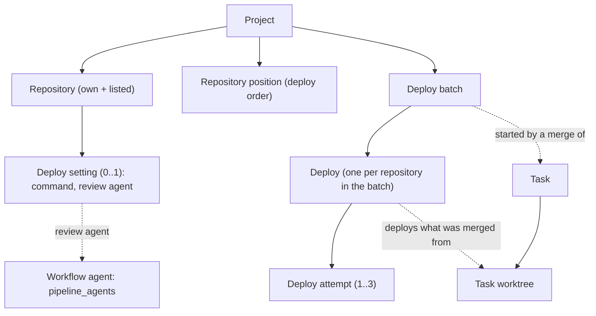
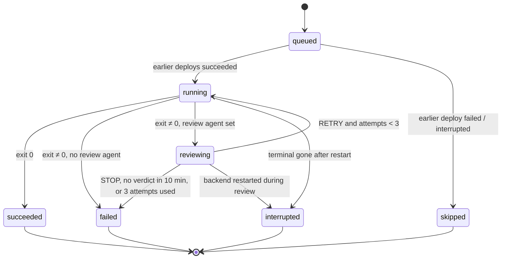

# Merge and deploy — Feature Specification

**Version:** 1.0
**Date:** 2026-11-23
**Status:** Draft
**Todo:** `docs/todos/2026-11-23-145623-merge-and-deploy.md`

## 1. Overview

When a workflow run finishes, its work sits in a task: one worktree and branch per repository the
task includes. Today the owner merges with **Merge into main** and then deploys by hand, usually by
asking an agent to push and run the `deploy` script from the repository's main checkout.

This feature makes that one action. Each repository of a project can carry a **deploy command**
(for example `git push origin main && deploy`) and an optional **review agent**. Then:

- **Merge and deploy** on a finished task merges every repository of the task with the existing
  merge, and deploys the ones that have a deploy command, one at a time, in the project's
  **deploy order**.
- **Deploy** in Main's strip deploys the chosen repository's main checkout as it stands, without a
  merge (a redeploy, or after a fix made on main by hand).

The deploy itself is deterministic: CodeDeck runs the command and reads its exit code. An agent is
used only when the command fails: the review agent reads the command, the exit code and the end of
the log and answers **RETRY** (a transient failure; CodeDeck runs the same command again) or
**STOP** (the failure needs a fix; CodeDeck records the agent's diagnosis). The agent never deploys,
edits, commits or pushes anything itself. Attempts are capped at three.

Deploying happens in the repository's main checkout (the project's path, or the checkout a listed
repository is kept in), never in a task worktree, because a deploy script builds from the working
tree as it is: after CodeDeck's merge that checkout is clean and on the branch the task was merged
into, so what is deployed is exactly what was merged.

## 2. Domain Hierarchy



- A **repository** is the project's own repository (named by its folder, the `own: true` entry
  `server/project-repositories.js` returns) or one of the repositories it lists. Repositories added
  to a single task from outside the project have no deploy setting and are never deployed.
- A **deploy batch** is one press of **Merge and deploy** or **Deploy**. It holds one **deploy** per
  repository to deploy, run in order.
- A **deploy attempt** is one run of the command, plus the review agent's verdict when it failed.

## 3. Feature Toggle

None. A repository without a deploy setting offers nothing new: its task bar row shows no
**Merge and deploy**, and Main's **Deploy** is disabled for it with the reason
"No deploy command is set for <repository>". A project in which no repository has a deploy command
shows no **Merge and deploy** and no **Deploy** at all. Remote (non-local) projects never offer
either.

## 4. Entity: RepositoryDeploySetting — table `repository_deploy_settings`

| Field | Type | Constraints | Default |
|---|---|---|---|
| `id` | TEXT | UUID, primary key | generated |
| `project` | TEXT | not null, an existing local project name | — |
| `repository` | TEXT | not null, the name of the project's own repository or one it lists | — |
| `command` | TEXT | not null, 1–2000 characters after trimming, no newline, carriage return or other control character | — |
| `review_agent_id` | TEXT | nullable; when set, the UUID of a row in `pipeline_agents` | null |
| `revision` | INTEGER | not null, ≥ 1, incremented on every update | 1 |
| `created_at` | TEXT | ISO-8601 UTC | now |
| `updated_at` | TEXT | ISO-8601 UTC | now |

Unique: (`project`, `repository`).

## 5. Entity: RepositoryPosition — table `project_repository_positions`

The deploy order, which is also the order the Repositories… dialog shows.

| Field | Type | Constraints | Default |
|---|---|---|---|
| `project` | TEXT | not null | — |
| `repository` | TEXT | not null | — |
| `position` | INTEGER | not null, ≥ 0 | — |
| `updated_at` | TEXT | ISO-8601 UTC | now |

Primary key: (`project`, `repository`). Unique: (`project`, `position`).

A project with no rows uses the order the dialog showed before this feature: its own repository
first, then the listed ones in their stored order. A repository with no row (listed after the order
was last saved) comes after every positioned one, in its stored order.

## 6. Entity: DeployBatch — table `deploy_batches`

| Field | Type | Constraints | Default |
|---|---|---|---|
| `id` | TEXT | UUID, primary key | generated |
| `project` | TEXT | not null | — |
| `task_id` | TEXT | nullable; the task whose merge started it | null |
| `trigger` | TEXT | not null, `merge` or `manual` | — |
| `status` | TEXT | not null, `DeployBatchStatus` (§9.1) | `running` |
| `created_at` | TEXT | ISO-8601 UTC | now |
| `finished_at` | TEXT | nullable; set when the status becomes terminal | null |

At most one batch per project has status `running` (enforced in the service, §10.4).

## 7. Entity: Deploy — table `deploys`

| Field | Type | Constraints | Default |
|---|---|---|---|
| `id` | TEXT | UUID, primary key | generated |
| `batch_id` | TEXT | not null, references `deploy_batches.id` | — |
| `project` | TEXT | not null, equal to the batch's | — |
| `repository` | TEXT | not null | — |
| `position` | INTEGER | not null, ≥ 0, unique within the batch; the order it runs in | — |
| `checkout_path` | TEXT | not null, absolute path of the main checkout it runs in | — |
| `branch` | TEXT | not null, the branch the checkout was on when the batch started | — |
| `commit` | TEXT | not null, 40-hex commit the checkout was at when the batch started | — |
| `command` | TEXT | not null; snapshot of the setting's command | — |
| `review_agent_id` | TEXT | nullable; snapshot of the setting's review agent | null |
| `task_worktree_id` | TEXT | nullable; the merged task worktree this deploys | null |
| `status` | TEXT | not null, `DeployStatus` (§9.2) | `queued` |
| `detail` | TEXT | nullable; the reason for `failed`, `skipped` or `interrupted` | null |
| `review_session_id` | TEXT | nullable; the review agent's terminal session | null |
| `started_at` | TEXT | nullable | null |
| `finished_at` | TEXT | nullable | null |

## 8. Entity: DeployAttempt — table `deploy_attempts`

| Field | Type | Constraints | Default |
|---|---|---|---|
| `id` | TEXT | UUID, primary key | generated |
| `deploy_id` | TEXT | not null, references `deploys.id` | — |
| `number` | INTEGER | not null, 1–3, unique within the deploy | — |
| `session_id` | TEXT | not null; the terminal session the command ran in | — |
| `exit_code` | INTEGER | nullable until the command ends; 0–255 | null |
| `log_tail` | TEXT | nullable until the command ends; at most 16 KiB (§10.6) | null |
| `verdict` | TEXT | nullable; `retry` or `stop`, only when the review agent answered | null |
| `verdict_reason` | TEXT | nullable; the agent's reason or diagnosis, at most 4000 characters | null |
| `started_at` | TEXT | not null | — |
| `finished_at` | TEXT | nullable | null |

## 9. Enums

### 9.1 DeployBatchStatus

| Value | Meaning |
|---|---|
| `running` | at least one deploy is queued, running or reviewing |
| `succeeded` | every deploy succeeded |
| `failed` | a deploy failed; the ones after it were skipped |
| `interrupted` | a deploy was interrupted (§10.8); the ones after it were skipped |

### 9.2 DeployStatus

| Value | Meaning |
|---|---|
| `queued` | waiting for the deploys before it |
| `running` | its command is running |
| `reviewing` | its command failed and the review agent is reading the result |
| `succeeded` | an attempt exited 0 |
| `failed` | the agent said STOP, gave no verdict, attempts ran out, or no review agent is set |
| `skipped` | an earlier deploy in the batch failed or was interrupted |
| `interrupted` | its command's terminal was gone after a backend restart, or the review was cut off |



## 10. Behavioral Rules

### 10.1 The deploy command

- It is the owner's own text, stored per repository and run as written by the owner's login shell
  (`$SHELL -lc '<command>'`, the command passed as one argument, never interpolated into another
  string) with the repository's main checkout as its working directory.
- The deploy snapshots the command when the batch starts; editing the setting later does not change
  a batch already started.
- An attempt runs in a new CodeDeck terminal session in that checkout (a tab in Main, opened without
  taking focus), whose tmux pane runs the command directly with `remain-on-exit on`. The exit code
  is the pane's `pane_dead_status` once `pane_dead` is 1. The owner can watch and type into it while
  it runs.

### 10.2 Before a batch starts (every repository in it)

A deploy of a repository may start only when all of these hold, checked when the batch is created;
the first one that fails refuses the whole batch with HTTP 409 and the reason, naming the
repository:

1. The repository has a deploy setting.
2. Its review agent, when set, still exists.
3. Its checkout exists, is a Git repository, has a branch checked out and is clean (no staged,
   unstaged or untracked files; ignored files do not count).
4. No unfinished workflow run has that checkout as its working directory.
5. The project has no batch with status `running`.

For a batch started by **Merge and deploy**, the checks run after the merges (§10.5) and only for
the repositories that have a deploy setting.

### 10.3 Running a batch

- Deploys run one at a time in `position` order. The next starts only when the one before it
  `succeeded`.
- When a deploy ends `failed` or `interrupted`, every later deploy in the batch becomes `skipped`
  with detail "Not deployed: <repository> failed first" (or "was interrupted first"), and the batch
  takes that status.
- When every deploy `succeeded`, the batch is `succeeded`.

### 10.4 Review and retry

- With no review agent, a non-zero exit makes the deploy `failed` with detail
  "<command> exited <code>".
- With a review agent, the deploy becomes `reviewing`. The first review opens a terminal session in
  the checkout, launches the agent with its launch command and, once it is ready, sends the review
  prompt; a later review in the same deploy reuses that terminal after the agent's reset command.
  The prompt contains the command, the exit code, the attempt number, the attempts left and the
  log tail, and says, in these words or equivalent:
  - read only: do not edit, commit, push, deploy or run `kubectl`, `docker` or the deploy command;
  - answer `[[CDD:<attempt-id>:RETRY]]` followed by one line of reason when the failure is
    transient and running the same command again is expected to succeed;
  - answer `[[CDD:<attempt-id>:STOP]]` followed by the diagnosis otherwise.
- The verdict is read from the terminal screen with the same screen-reading the workflow engine
  uses for its signals. The text after the marker, up to 4000 characters, is `verdict_reason`.
- RETRY with fewer than 3 attempts made starts the next attempt. RETRY on the third attempt, STOP,
  and no verdict within 10 minutes of sending the prompt make the deploy `failed`; the detail is
  the agent's diagnosis, "Stopped after 3 attempts", or "The review agent gave no verdict".
- A review agent that asks a question instead of a verdict gets no answer from CodeDeck; it is a
  missing verdict.

### 10.5 Merge and deploy

**One repository** (a row of the task bar): the existing merge of that worktree runs first,
unchanged. If it is refused or conflicts, nothing is deployed and the response carries the merge
result. If it succeeds and the repository has a deploy setting, a batch with that one repository
starts (§10.2).

**The whole task** (task bar header):

1. **Pre-check.** For every open worktree of the task, the existing landing view must say it can
   be merged. If any cannot, nothing is merged and the 409 lists each blocked repository with its
   reason.
2. **Merge** each open worktree with the existing merge, in deploy order (repositories with no
   position last, by name). If one is refused or conflicts anyway, merging stops; the ones already
   merged stay merged, nothing is deployed, and the response lists merged, failed and not-attempted
   repositories.
3. **Deploy.** When every merge succeeded, one batch starts with the merged repositories that have
   a deploy setting, in deploy order. Repositories without one were merged only.

A failed deploy never undoes a merge. If §10.2 refuses the batch after the merges, the merges stay
and the response says why the deploy did not start.

### 10.6 Log tail

When the command's pane is dead, CodeDeck captures the last 200 lines of the pane
(`tmux capture-pane -p -S -200`), strips control sequences and keeps the last 16 KiB.

### 10.7 Confirmation (client)

Both buttons open a confirmation before calling the backend. It lists each repository to deploy
with its branch, current commit (short) and command, and the repositories that will only be
merged. Pressing **Deploy** in it is the request; cancelling sends nothing.

### 10.8 Backend restart

On startup, for every deploy with status `running`:

- its attempt's tmux session exists and the pane is alive → keep watching it;
- the pane is dead → record its exit code and log tail and continue as in §10.3–10.4;
- the session is gone → the deploy is `interrupted` with detail "The deploy terminal was gone after
  a restart; check the target before deploying again".

A deploy with status `reviewing` at startup becomes `interrupted` with detail "The review was cut
off by a restart". `queued` deploys continue when the deploy before them ends.

### 10.9 Settings and order

- Removing a repository from the project's list deletes its deploy setting and its position.
  Deleting a project deletes all of its settings and positions; its batches are kept.
- Deleting a workflow agent used as a review agent by any setting is refused with 409 naming the
  project and repository of each.
- Saving the order takes the full list of the project's repository names, each once; any other
  list is a 400.

### 10.10 Terminals

A batch's terminals (each attempt's and each review agent's) stay open after it ends so the owner
can read them. **Close** in the deploy view closes them, skipping ones already gone, and reports how
many were closed; it is refused (409) while the batch is `running`.

### 10.11 Notifications

The phone gets a push when a batch ends: "Deployed <repositories>" on `succeeded`, and
"Deploy failed: <repository>" on `failed` or `interrupted`, using the existing push sender. The
desktop shows a toast for the same events while it is open.

### 10.12 Where it is shown (client)

- **Repositories… dialog**: each repository row has a drag handle (deploy order) and a **Deploy**
  section with the command, the review agent (a select of the workflow agents, with "No review"),
  **Save** and **Remove**. Saving shows a toast on success and failure.
- **Task bar**: **Merge and deploy** beside **Merge into <branch>** on each repository row that
  has a deploy setting, and in the header for the whole task when at least one open repository has
  one. Disabled, with the merge's own reason, whenever Merge is.
- **Main's strip**: **Deploy** beside **Run workflow**, deploying the repository chosen in Main's
  repository chooser, disabled with the reason from §10.2 when it would be refused. While a batch
  runs, a chip reads "Deploying <repository> <n>/<total>"; after it ends, "Deployed" or
  "Deploy failed" until the next batch. The chip opens the deploy view.
- **Deploy view**: the project's batches, newest first and paginated; each lists its deploys with
  status, attempts (exit code, verdict, reason, log tail) and a link to each terminal, and **Close**.
- **Changes**: each landed repository shows its latest deploy's status (from deploys whose
  `task_worktree_id` is that worktree), or "Not deployed".

### 10.13 Preconditions at the edges

Every field of every request body, every row hydrated from the four new tables, and every
domain-object factory is guarded per field (presence, type, format, range, enum), failing loudly
with the field and the row or request identity. A row with an unknown status, a non-UUID id, a
`number` outside 1–3, or a `commit` that is not 40 hex characters throws when read.

## 11. API Endpoints

All errors are RFC 9457 problem details with `traceId` (as `server/routes/tasks.js` and
`server/routes/project-repositories.js` already do); every 400 carries field-level `errors`.

| Method | Path | Action | Status |
|---|---|---|---|
| PUT | `/api/projects/:name/repositories/:repository/deploy-setting` | create or update a setting | 200, 400, 404, 409 (stale revision, remote project) |
| DELETE | `/api/projects/:name/repositories/:repository/deploy-setting` | remove a setting | 204, 404 |
| PUT | `/api/projects/:name/repository-order` | save the deploy order | 200, 400, 404 |
| GET | `/api/projects/:name/repositories` | existing; each item adds `position` and `deploy` | 200 |
| POST | `/api/projects/:name/deploy-batches` | start a manual batch | 201, 400, 404, 409 |
| GET | `/api/projects/:name/deploy-batches` | list batches, paginated | 200, 400, 404 |
| GET | `/api/deploy-batches/:id` | one batch with its deploys and attempts | 200, 404 |
| POST | `/api/deploy-batches/:id/close` | close the batch's terminals | 200, 404, 409 |
| POST | `/api/tasks/:id/merge-and-deploy` | merge the whole task, then deploy | 200, 404, 409 |
| POST | `/api/tasks/:id/worktrees/:worktreeId/merge-and-deploy` | merge one repository, then deploy | 200, 404, 409 |
| GET | `/api/tasks/changes` | existing; each landed repository adds `deploy` | 200 |
| DELETE | `/api/pipelines/agents/:id` | existing; now 409 when used as a review agent | 409 |

`GET /api/projects/:name/deploy-batches`: `page` (default 0), `size` (default 20, max 100),
`sort` only `-createdAt` (tie: `id`), filter `status` (exact, one of §9.1).

## 12. Request/Response Schemas

**PUT deploy-setting** request:
```json
{ "command": "git push origin main && deploy", "reviewAgentId": "3f1c…-uuid", "revision": 2 }
```
`reviewAgentId` may be `null`; `revision` is omitted when creating and required when updating.
Response:
```json
{ "project": "sentinel", "repository": "backend", "command": "git push origin main && deploy",
  "reviewAgentId": "3f1c…", "revision": 3, "updatedAt": "2026-11-23T13:00:00Z" }
```

**PUT repository-order** request: `{ "repositories": ["backend", "frontend", "mobile-app"] }` →
`{ "repositories": ["backend", "frontend", "mobile-app"] }`.

**POST deploy-batches** request: `{ "repositories": ["backend"] }` → 201 with a batch view.

**Batch view**:
```json
{
  "id": "…", "project": "sentinel", "taskId": null, "trigger": "manual", "status": "running",
  "createdAt": "…", "finishedAt": null,
  "deploys": [
    { "id": "…", "repository": "backend", "position": 0, "branch": "main", "commit": "40-hex",
      "command": "git push origin main && deploy", "reviewAgentId": "…", "taskWorktreeId": null,
      "status": "reviewing", "detail": null, "reviewSessionId": "sentinel-7",
      "startedAt": "…", "finishedAt": null,
      "attempts": [
        { "number": 1, "sessionId": "sentinel-6", "exitCode": 1, "logTail": "…",
          "verdict": null, "verdictReason": null, "startedAt": "…", "finishedAt": "…" }
      ] }
  ]
}
```

**POST merge-and-deploy** response (200 whenever the merge step ran):
```json
{
  "merges": [
    { "repository": "backend", "outcome": "merged", "mergedCommit": "40-hex" },
    { "repository": "frontend", "outcome": "conflict", "files": ["src/a.js"] },
    { "repository": "docs", "outcome": "not_attempted" }
  ],
  "task": { "…": "existing task view" },
  "deploy": { "started": false, "reason": "frontend could not be merged; nothing was deployed" }
}
```
When the batch starts: `"deploy": { "started": true, "batch": { …batch view… } }`. Merge outcomes:
`merged`, `conflict`, `refused`, `not_attempted`. The 409 for the pre-check (§10.5 step 1) is a
problem detail with `blocked: [{ "repository", "reason" }]`.

**Changes item** adds per landed repository:
`"deploy": { "status": "succeeded", "batchId": "…", "finishedAt": "…" }` or `null`.

## 13. Acceptance Criteria

1. A deploy setting can be saved, updated with the current revision, refused with a stale one, and
   removed; an invalid command (empty, too long, newline, control character) is a 400 naming
   `command`; an unknown review agent is a 404.
2. The deploy order saves only a full permutation of the project's repository names and is returned
   by `GET /api/projects/:name/repositories` as `position`.
3. A manual batch on a clean checkout runs the command in a tmux pane in that checkout, records exit
   code 0 and the log tail, and ends `succeeded` (verified against a temporary Git repository and
   real tmux with a command such as `echo deployed`).
4. A command that exits non-zero with no review agent ends `failed` with its exit code.
5. With a review agent (a stub CLI in tests that prints a scripted marker), RETRY reruns the
   command, a third failed attempt ends `failed` with "Stopped after 3 attempts", STOP ends
   `failed` with the diagnosis, and no marker within the (test-shortened) timeout ends `failed`.
6. A batch is refused (409, naming the repository) for a dirty checkout, a checkout used by an
   unfinished run, a missing setting, and while another batch of the project is running.
7. In a two-repository batch a failure of the first leaves the second `skipped` and never runs its
   command.
8. Merge and deploy for one repository merges with the existing merge and starts a batch only when
   the merge succeeded; a conflict starts no batch and leaves the merge aborted as today.
9. Merge and deploy for the whole task refuses to merge anything when any open worktree is blocked,
   merges in deploy order, deploys only repositories with a setting, and reports merges kept when a
   later merge conflicts.
10. After a simulated restart a running deploy whose pane is alive keeps being watched, one whose
    pane is dead records its exit, and one whose session is gone becomes `interrupted` and skips
    the rest.
11. `GET /api/tasks/changes` shows each landed repository's latest deploy status.
12. Deleting a workflow agent used as a review agent is refused with 409.
13. A batch ending sends exactly one push through the push sender (verified with a test double).
14. The client shows the Deploy section, drag order, the buttons with their disabled reasons, the
    confirmation, the chip and the deploy view, with toasts for every mutating call's success and
    failure (component tests), and the client builds.

## 14. Assumptions

- ASSUMPTION: CodeDeck does not write a changelog. The owner's workflows write it in the task
  before the merge, and the deploy command pushes. Reason: the command is the owner's, and a commit
  made on main by CodeDeck would dirty the checkout it is about to deploy.
- ASSUMPTION: three attempts in total and a ten-minute review timeout, both constants. Reason: a
  transient registry or rollout failure rarely needs more; owner-configurable limits can be added
  when one is needed.
- ASSUMPTION: the review agent gets no answers to questions. Reason: its only job is a verdict, and
  waiting for the owner would hold the whole batch.
- ASSUMPTION: whole-task merges run in deploy order, so a backend lands before the frontend that
  depends on it.
- ASSUMPTION: batches of a deleted project are kept, read-only, as a record of what was deployed.
