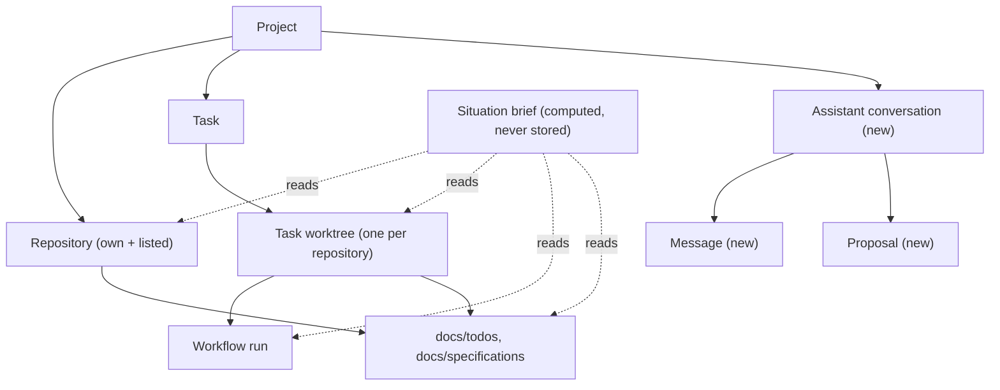
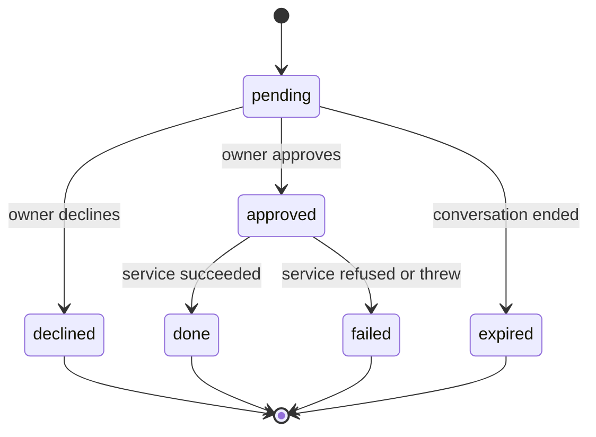
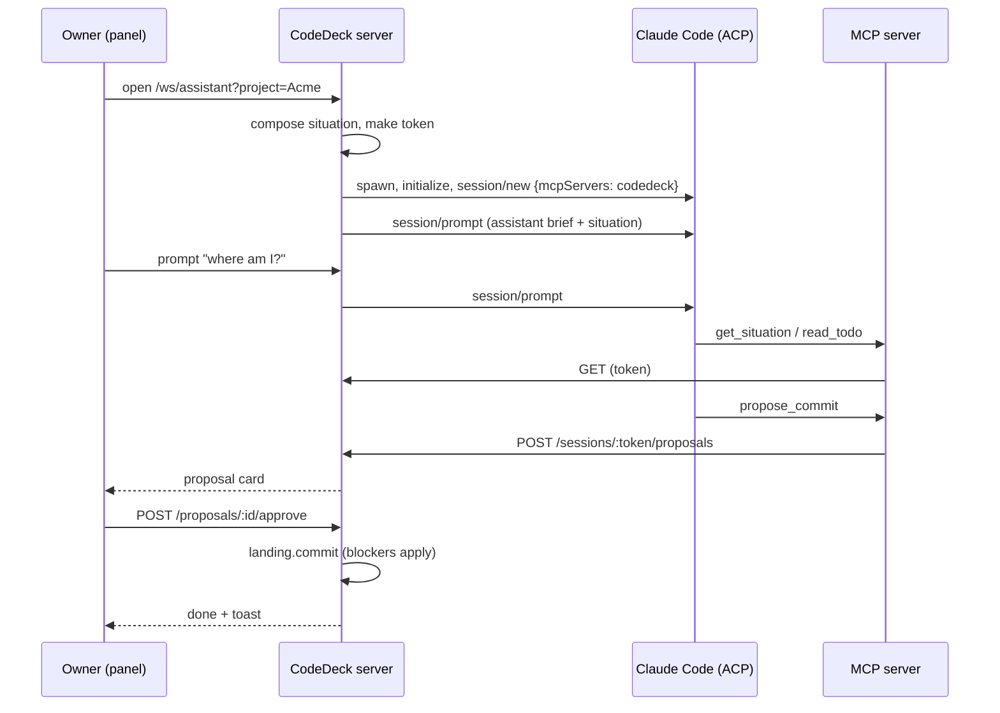
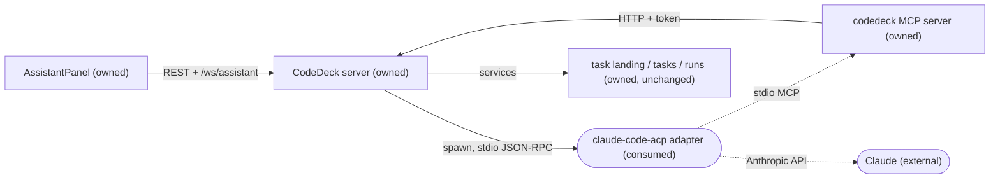

# Project Assistant — Feature Specification

**Version:** 1.0
**Date:** 2026-11-25
**Status:** Draft

## 1. Overview

An owner who works across Main, several tasks and several repositories of one project loses track
of where things stand. The case that prompted this (Acme, 2026-11-25):

- A run read **Complete**. Its Test step had stopped at its round limit and the owner had continued,
  so the todo was really on Phase 2 (4 of 6 tasks), with Phases 3–5 not started.
- The task's branch had no commits and 22 uncommitted files.
- Merge was refused because Main had unrelated uncommitted files.
- A second spec and todo had been written by hand in another tab. That todo could not start until
  the first todo's Phase 2 was closed.
- The last step note pointed at another repository (frontend), whose own `main` had uncommitted
  work too.

Working that out took a dozen Git and file commands. Every fact was already readable by CodeDeck.

The **Project Assistant** is a chat panel on the right of the workspace, for the project on screen.
The owner talks to an agent (Claude Code, over the Agent Client Protocol). The agent sees the whole
project through a **situation brief** that the backend composes from what it already reads: Main
and every repository the project lists, every open task and its worktrees, their runs, and the
specifications and todos in each of them. The brief names the facts that mislead the owner as
**flags**. The agent explains, recommends one next step, and acts only through **proposals**. A
proposal is a card in the panel that does nothing until the owner chooses **Approve**. An approved
proposal runs through the same CodeDeck service as the matching button, so every blocker still
applies and nothing is forced.

The panel is useful before anything is asked: its header shows the flags.

### Out of scope

- Agents whose provider has no ACP server (Cursor) and agents with a custom command. Settings lists them with the reason. (Version 1.0 supported Claude Code only; since 2026-11-27 any saved Claude Code, Codex, Antigravity, Muse or OpenCode agent can be chosen.)
- Remote projects. The situation of a remote project is refused with 409.
- More than one project per conversation.
- Remembering the agent's own context across a restart of its process. The transcript is kept;
  the agent starts fresh and the panel says so (§8.6).
- Changing the existing landing, task or run endpoints. The assistant only calls their services.
- The terminal-pane chat of the `feature/agent-chat-pane` prototype. That branch is not merged;
  only its bridge and rendering code are reused (§8.5).

## 2. Domain Hierarchy



A conversation belongs to one project. A project has at most one **current** conversation;
**New conversation** ends it and starts another.

## 3. Feature Toggle

None. The panel is always available for a local project. When the ACP adapter cannot start, the
panel shows the reason (§8.5) and the situation header still works.

## 4. Entities

### 4.1 Conversation — `assistant_conversations`

| Field | Type | Constraints | Default |
|---|---|---|---|
| id | TEXT | UUID, primary key | generated |
| project | TEXT | not null, 1–200 characters, a configured project's name | — |
| state | TEXT | `current` or `ended` | `current` |
| created_at | TEXT | ISO-8601 UTC, not null | now |
| ended_at | TEXT | ISO-8601 UTC, null while `current` | null |

Unique: at most one `current` row per project (partial unique index on `project` where
`state = 'current'`).

### 4.2 Message — `assistant_messages`

| Field | Type | Constraints | Default |
|---|---|---|---|
| id | INTEGER | primary key, autoincrement | — |
| conversation_id | TEXT | not null, FK → `assistant_conversations.id` | — |
| role | TEXT | `owner`, `agent`, `tool` or `notice` | — |
| content | TEXT | not null, 1–200,000 characters | — |
| tool_name | TEXT | not null when role is `tool`, null otherwise, 1–100 characters | null |
| proposal_id | TEXT | null, or FK → `assistant_proposals.id` | null |
| created_at | TEXT | ISO-8601 UTC, not null | now |

An agent turn is stored as one `agent` message when the turn ends (`turn_end`), not chunk by chunk.
A `notice` is a line the panel writes itself, for example "The assistant restarted and no longer
remembers this conversation" (§8.6).

### 4.3 Proposal — `assistant_proposals`

| Field | Type | Constraints | Default |
|---|---|---|---|
| id | TEXT | UUID, primary key | generated |
| conversation_id | TEXT | not null, FK → `assistant_conversations.id` | — |
| project | TEXT | not null, equals the conversation's project | — |
| kind | TEXT | one of §5.2 | — |
| payload | TEXT | JSON, not null, valid for `kind` per §7.4 | — |
| summary | TEXT | not null, 1–300 characters, one line | — |
| reason | TEXT | not null, 1–2,000 characters: why the agent proposes it | — |
| state | TEXT | one of §5.3 | `pending` |
| result | TEXT | JSON, null until `done` or `failed` | null |
| created_at | TEXT | ISO-8601 UTC, not null | now |
| decided_at | TEXT | ISO-8601 UTC, null while `pending` | null |
| finished_at | TEXT | ISO-8601 UTC, null until `done` or `failed` | null |

Every field read back from SQLite is checked when a row is hydrated. A bad value fails loudly with
the row id and the column name (never the value of `payload` or `result`).

## 5. Enums

### 5.1 Message role

| Value | Meaning |
|---|---|
| `owner` | What the owner typed |
| `agent` | The agent's text for one turn |
| `tool` | A CodeDeck tool the agent called, with a one-line summary of its outcome |
| `notice` | A line from CodeDeck itself |

### 5.2 Proposal kind

| Value | Carried out by |
|---|---|
| `commit` | `landing.commit` (task-level, or one worktree with `worktreeId`) |
| `merge` | `landing.merge` (task-level or one worktree) |
| `pull_request` | `landing.pullRequest` (task-level or one worktree) |
| `close` | `landing.close` / `landing.closeWorktree`; never with `deleteIgnored` |
| `new_task` | the task service's create path behind `POST /api/tasks` |
| `start_run` | the run start path behind `POST /api/pipelines/runs` |

### 5.3 Proposal state



`approved` is held only while the service runs. A proposal is decided once: a second approve or
decline returns 409.

### 5.4 Situation flag code

| Code | Raised when |
|---|---|
| `run_complete_todo_unfinished` | A run is `complete` and one of its steps has status `limit_accepted`, or its own progress (the run view's `progress`, read in the run's worktree) still has unticked boxes |
| `work_uncommitted_no_commits` | A task worktree has uncommitted files and `commitsAhead` is 0 |
| `merge_blocked` | A task worktree with commits or uncommitted work has merge blockers; the flag carries their `{code, message}` |
| `todo_not_started` | A todo has phases and no ticked box |
| `todo_depends_on_unfinished` | A todo's header names another todo (by path) that has an unfinished phase |
| `other_repository_dirty` | A repository checkout of the project (Main of any listed repository) has uncommitted files |
| `stray_files` | An untracked path, in a repository checkout or a task worktree, whose name is empty after trimming whitespace, or consists only of whitespace, backslashes and the letters of an escape such as `\n` and contains at least one whitespace character or backslash |

## 6. API Endpoints

All errors are RFC 9457 problem documents with `timestamp`, `status`, `error`, `message`, `path`,
`traceId` and a matching `X-Trace-Id` header. A 400 carries `errors` with one entry per field.
Unknown query and body fields are 400. Paging, filtering and sorting use
`server/routes/collection-query.js` (`size` 1–100, default 20, `sort=field,asc|desc` with an id
tiebreaker).

### 6.1 Situation — `server/routes/assistant.js`

| Method | Path | Action | Status |
|---|---|---|---|
| GET | `/api/projects/:name/situation` | Compose the situation of the project | 200; 404 unknown project; 409 remote project |

Not a collection: it is one document per project. Its lists are bounded (§8.1.6).

### 6.2 Conversation

| Method | Path | Action | Status |
|---|---|---|---|
| GET | `/api/assistant/conversations/current?project=` | The project's current conversation, created when it has none | 200; 400; 404 unknown project |
| POST | `/api/assistant/conversations` | `{project}`: end the current conversation (its pending proposals become `expired`) and start a new one | 201; 400; 404 |
| GET | `/api/assistant/conversations/:id/messages` | Paginated messages. Sort `createdAt` (default `createdAt,asc`, id tiebreaker) | 200; 400; 404 |

### 6.3 Proposals

| Method | Path | Action | Status |
|---|---|---|---|
| GET | `/api/assistant/proposals` | Paginated. Filters `project` (exact, required), `conversationId`, `state`. Sort `createdAt` (default `createdAt,desc`) | 200; 400 |
| GET | `/api/assistant/proposals/:id` | One proposal | 200; 404 |
| POST | `/api/assistant/proposals/:id/approve` | No body. Carry the proposal out (§8.4) | 200 with the proposal in `done`; 409 not pending; 409 `failed` with the service's `reasons` or `conflicts`; 404 |
| POST | `/api/assistant/proposals/:id/decline` | No body | 200; 409 not pending; 404 |

The MCP server creates proposals through an internal route that is not reachable without the
session token (§8.3):

| Method | Path | Action | Status |
|---|---|---|---|
| POST | `/api/assistant/sessions/:token/proposals` | `{kind, payload, summary, reason}` | 201; 400; 401 unknown or ended token; 409 when the conversation already has 10 pending proposals |

### 6.4 WebSocket

`/ws/assistant?project=<name>` is mounted in the existing upgrade handler (`server/index.js`)
after `privateAccess.authorizeUpgrade`. An unauthorised upgrade is refused exactly as
`/ws/terminal` is. An unknown or remote project closes the socket with code 4404 or 4409 and a
reason.

## 7. Request/Response Schemas

### 7.1 Situation

```json
{
  "project": "Acme Local",
  "generatedAt": "2026-11-25T20:10:12Z",
  "repositories": [
    { "name": "backend", "own": true, "path": "/Users/x/git/acme/backend", "branch": "main",
      "dirtyCount": 30, "dirty": ["src/main/.../DeskMcpClient.java"] }
  ],
  "tasks": [
    { "id": "t-1", "title": "Build integration provider Phase 1", "state": "active",
      "worktrees": [
        { "worktreeId": "w-1", "repository": "backend", "worktreePath": "/Users/x/git/acme/worktrees/backend-integration-provider-spec",
          "branch": "docs/integration-provider-spec", "baseBranch": "main",
          "uncommittedCount": 22, "commitsAhead": 0, "commitsBehind": 0,
          "blockers": { "commit": [], "merge": [{ "code": "main_dirty", "message": "Main has uncommitted changes. Commit or stash them before merging." }],
                        "pullRequest": [], "close": [] },
          "strayFiles": [" ", "\\n"] }
      ],
      "runs": [
        { "id": "r-1", "workflow": "Feature Build from Spec", "status": "complete",
          "steps": [{ "index": 2, "name": "Test", "status": "limit_accepted" }],
          "progressFile": "docs/todos/2026-11-25-165446-integration-provider.md",
          "lastNote": { "stepIndex": 2, "firstLine": "…" } }
      ] }
  ],
  "todos": [
    { "path": "docs/todos/2026-11-25-165446-integration-provider.md", "location": "task:t-1/w-1",
      "title": "Integration provider", "spec": "docs/specifications/2026-11-25-165446-integration-provider-spec.md",
      "status": "In Progress", "dependsOn": [],
      "phases": [ { "number": 1, "title": "Workspace integration keys and machine authentication", "done": 10, "total": 10 },
                  { "number": 2, "title": "Posted bank-row feed", "done": 4, "total": 6 } ],
      "committed": false }
  ],
  "specifications": [ { "path": "docs/specifications/…-spec.md", "location": "task:t-1/w-1", "committed": false } ],
  "flags": [
    { "code": "run_complete_todo_unfinished", "message": "Run “Build integration provider Phase 1” is complete, but its todo is on Phase 2 (4 of 6) with 3 phases not started.",
      "where": { "taskId": "t-1", "runId": "r-1", "path": "docs/todos/2026-11-25-165446-integration-provider.md" } }
  ],
  "truncated": { "dirty": false, "todos": false },
  "markdown": "# Acme Local — where things stand\n…"
}
```

`location` is `main:<repository>` or `task:<taskId>/<worktreeId>`. `committed` is false when the
file is untracked or modified in that working copy.

### 7.2 Conversation and message

```json
{ "id": "c-1", "project": "Acme Local", "state": "current", "createdAt": "…", "endedAt": null }
```
```json
{ "id": 41, "conversationId": "c-1", "role": "agent", "content": "…", "toolName": null,
  "proposalId": null, "createdAt": "…" }
```

### 7.3 Proposal

```json
{ "id": "p-1", "conversationId": "c-1", "project": "Acme Local", "kind": "commit",
  "payload": { "taskId": "t-1", "worktreeId": "w-1", "message": "wip(integration): provider phases 1–2" },
  "summary": "Commit 22 files in “Build integration provider Phase 1” (backend)",
  "reason": "Nothing is committed on the task branch yet; a checkpoint protects the work.",
  "state": "pending", "result": null, "createdAt": "…", "decidedAt": null, "finishedAt": null }
```

### 7.4 Proposal payloads

| Kind | Payload | Rules |
|---|---|---|
| `commit` | `{taskId, worktreeId?, message}` | `message` 1–200 characters, one line |
| `merge` | `{taskId, worktreeId?}` | — |
| `pull_request` | `{taskId, worktreeId?, remote}` | `remote` 1–100 characters |
| `close` | `{taskId, worktreeId?}` | `deleteIgnored` is not accepted |
| `new_task` | `{title, repositories?}` | as `POST /api/tasks`; `project` is the conversation's |
| `start_run` | `{workflowId, input, teamId, taskId?, newTask?, startIn?}` | as `validateRunStartBody`; `project` is the conversation's; `requestId` is the proposal id |

`taskId` must name an open task of the conversation's project; `worktreeId` must belong to it.
A payload that fails these is refused with 400 when the proposal is created, not when approved.

### 7.5 WebSocket messages

Browser → server: `{type:'prompt', text}`, `{type:'cancel'}`,
`{type:'permission_response', requestId, outcome}`.

Server → browser: `{type:'ready', conversationId, restarted}`, `{type:'update', update}`
(the raw ACP `session/update`), `{type:'turn_end', messageId}`,
`{type:'permission_request', requestId, toolCall, options}`,
`{type:'proposal', proposal}`, `{type:'situation', flags}`,
`{type:'spawn_error', message}`, `{type:'agent_exit', code, signal, stderrTail}`, `{type:'error', message}`,
`{type:'message', message}` (a stored message: the owner's prompt once saved, and every notice, such as
"The assistant was opened elsewhere." on takeover and the restart notice) and
`{type:'auth', state, label}` (the adapter's sign-in state). The full field list is in
`docs/steering/api-standards.md` (Assistant).

## 8. Behavioral Rules

### 8.1 Composing the situation

1. **Repositories** come from `createProjectRepositories().list` (`server/project-repositories.js`).
   Each one's dirty paths come from `listDirtyPaths` (`server/pipelines/run-worktree.js`).
2. **Tasks** are the project's open tasks from the task store. Each worktree's view comes from
   `landing.worktrees(id)` (`server/tasks/task-landing.js`), unchanged.
3. **Runs** are the project's open runs (`isOpenRun` in `server/pipelines/run-worktree-hold.js`; a run the owner closed is `released` and is left out), with the run view the pipelines route
   already builds. That builder is exported from a module the composer can call without a request,
   and the route keeps using it.
4. **Todos and specifications** are found by listing `docs/todos/*.md` and
   `docs/specifications/*.md` (not recursively) in every repository checkout and every open task
   worktree. The working copy is read, because uncommitted todos matter. For each todo:
   - the first `# ` heading
   - the `**Spec**`, `**Status**` and `**Repositories**` lines (the last through
     `parseTodoRepositories`)
   - every `docs/todos/…md` path named in a `>` header note before the first `##`, as `dependsOn`
   - the per-phase counts from `parsePhaseBreakdown`
5. `parsePhaseBreakdown(markdown)` is added to `server/pipelines/run-progress.js`. It returns
   `[{number, title, done, total}]`, using the same phase and box rules as `parsePhaseProgress`;
   `parsePhaseProgress` is rebuilt on top of it, with its tests unchanged.
6. **Bounds.**
   - At most 50 dirty paths per repository and 50 todos and 50 specifications per location; the
     last 50 by file name (newest, for the date-prefixed names todos and specs use) are kept when there are more.
   - Files over 512 KiB are skipped and listed under `skipped` with their size.
   - `truncated` says which lists were cut.
7. A location whose folder is gone is reported with `missing: true` and nothing else read from it.
   A repository the repository service reports as not usable (for example `not_git_toplevel`, a
   folder that is not a Git working tree) is reported as `{name, own, path, usable: false, reason}`,
   no Git command runs in it and it raises no flag; the panel lists it with its reason instead of
   "Nothing needs your attention". Every other repository has `usable: true`.
7a. A path read from Git is any non-empty string and is never trimmed: a file may be named `" "`.
7b. A run's `progress` follows the run view: when its progress file is missing or unreadable,
   `phaseCount`, `tasksDone` and `tasksTotal` are null.
8. The run store holds every project's runs; a run is checked further only once it is known to
   belong to a task being read. Every value read from Git, the file system or SQLite is checked when the composer builds its
   objects. A violation throws with the task id, worktree id or path named. The route returns 500
   with the trace id, and the panel header shows the message.
9. The composer reads only. It never writes a file, runs a Git command that changes anything, or
   takes a lock.

### 8.2 Flags

Flags are computed by a pure function `situationFlags(facts)` in `server/assistant/situation-flags.js`,
one rule per code in §5.4, in the order given there. Each message is one sentence in plain words
and names the task by title and the todo by path. `todo_depends_on_unfinished` names the phase
that is not closed. Every task worktree holds the todos committed in Main, so todos are keyed by
repository and path, and copies are compared by content: a task copy identical to the Main copy of
the same repository is not a separate todo, and that task's location is listed under the Main copy
as `alsoIn`; a task copy that differs is its own todo, judged on its own. A run is judged only by
its own progress (§5.4), never by another location's copy.

### 8.3 The agent's CodeDeck tools (MCP)

1. `server/assistant/mcp-server.js` is a stdio MCP server built on `@modelcontextprotocol/sdk`. It
   is passed to the agent in `session/new` as `mcpServers: [{ name: 'codedeck', command:
   process.execPath, args: [<path>], env: [{name:'CODEDECK_ASSISTANT_URL'}, {name:'CODEDECK_ASSISTANT_TOKEN'}] }]`.
2. The token is random (32 bytes, hex) and made per agent session. It is kept in server memory
   only and ends when the agent process exits. It authorises the routes the tools call, for that
   conversation's project only.
3. **Read tools:**
   - `get_situation` returns `markdown` and `flags`.
   - `get_task_landing(taskId)` returns the worktrees view.
   - `read_todo(location, path)` returns at most 512 KiB of a todo or spec found by §8.1.4.
   - `read_run_notes(runId, stepIndex)` returns the last written note.
   - `list_runs(taskId?)`
4. **Propose tools** (`propose_commit`, `propose_merge`, `propose_pull_request`, `propose_close`,
   `propose_new_task`, `propose_start_run`) create a proposal and return
   `{proposalId, state:'pending'}` straight away. They never wait for the owner. The agent is told
   to stop and say what it proposed.
5. When a proposal is decided, the next prompt the owner sends is prefixed with one line per
   decision since the last prompt: `[CodeDeck] Proposal p-1 (commit): done — <one-line result>`.
6. A tool that fails returns an MCP error with the problem's `message`. It is stored as a `tool`
   message.

### 8.4 Carrying out a proposal

1. Approve sets `approved` and `decided_at`, then calls the service named in §5.2 with the payload.
   It never calls the HTTP route.
2. The service's own checks run unchanged. A refusal (blockers, conflicts, missing CLI) sets
   `failed` with `result = {status, message, reasons?, conflicts?}`, and the route answers 409 with
   that problem. A thrown error sets `failed` with the message and answers 500.
3. Success sets `done` with `result` = the service's response (task, landing status, run id).
4. Two approvals of the same proposal at once run the service once: the transition from `pending`
   is a single conditional `UPDATE … WHERE state = 'pending'`, and the loser gets 409.
5. `close` never deletes ignored files. When the only blocker is `ignored_files`, the proposal fails
   with that blocker and the owner closes from the landing bar.
6. `start_run` uses the proposal id as `requestId`, so a retried approval cannot start two runs.
7. Every approval and decline is logged with the proposal id, kind and outcome, never the payload.

### 8.5 The agent process (ACP)

1. `server/acp-bridge.js` and its tests are copied from `feature/agent-chat-pane` (commit
   `13796d5`). The branch is not merged.
2. The bridge spawns the Claude Code ACP adapter in the project's own path. It strips
   `CLAUDECODE` and `CLAUDE_CODE_ENTRYPOINT` from the environment, sends `initialize`, then
   `session/new` with the MCP server of §8.3.
3. The adapter package is `@agentclientprotocol/claude-agent-acp` (the renamed
   `@zed-industries/claude-code-acp`), pinned exactly to 0.106.0: the newest release at least two
   weeks old on the day it was added. Its entry point is the package's `bin` path `dist/index.js`,
   found through its `package.json`, because the package exports only `.`.
4. Each agent session receives the **assistant brief** via `session/new`'s `systemPrompt: { mode: 'append', content: [{ type: 'text', text }] }`:
   - The role: help the owner understand where the project stands and what to do next.
   - The rules: answer from the situation and the tools, and say when something is not known;
     recommend one next step; act only through `propose_*` tools; never run Git commands that
     change anything, and never edit files unless the owner asks for it in this conversation.
   - The current situation `markdown`.

   This brief is not shown as an owner message and consumes no extra turn. The panel shows a
   `notice` ("Assistant briefed on the current situation.").
5. Claude Code's own tools stay available. Every `session/request_permission` is shown in the panel
   with its options. The owner's choice is sent back unchanged, and nothing is allowed by default.
6. One agent process per open panel socket. Closing the socket ends the process and its token.
   A socket for a project that already has a live agent process ends the older socket with a
   `notice`. A second browser tab therefore takes over; it never runs two agents on one
   conversation.
7. A spawn failure sends `spawn_error` with the adapter's message. The panel shows it with the
   adapter name and keeps the situation header.

### 8.6 The conversation

1. Opening the panel loads the project's current conversation and its messages from the backend,
   then opens the socket.
2. The owner's text is stored as an `owner` message before it is sent to the agent. An agent turn
   is stored when it ends. Tool calls are stored as `tool` messages.
3. When a socket opens on a conversation that already has messages, the agent starts fresh.
   `ready.restarted` is true, and a `notice` says the assistant does not remember the earlier
   messages and has been briefed again.
4. **New conversation** asks for confirmation when proposals are pending, then calls
   `POST /api/assistant/conversations`.
5. Messages are never edited or deleted. An ended conversation is not shown again in v1.

### 8.7 The panel

1. `client/src/components/assistant/AssistantPanel.jsx` sits on the right of the workspace, for
   the active project. It is opened and closed by a button in the top bar and by **⌘/Ctrl+⇧L**,
   which is added to `ShortcutsOverlay.jsx`. Whether it is open is a per-browser convenience in
   `localStorage`; nothing authoritative is stored there.
2. **Header, "Where things stand":** the flags from `GET /api/projects/:name/situation`, one line
   each, the task or todo named in bold. It is refreshed on open, on **Refresh**, after every
   proposal is decided, and every 30 seconds while the panel is open. With no flags it says
   "Nothing needs your attention".
3. **Messages:** owner and agent messages rendered as Markdown (`marked` + `dompurify`). Tool calls
   are shown as one-line cards, permission requests as cards with the adapter's options, and
   notices in muted text.
4. **Proposal cards:** summary, reason, the payload in words, and **Approve** / **Decline**. While a
   request is in flight the card shows a spinner and both buttons are disabled. The outcome replaces
   the buttons: done (with the result in words), failed (with the message and reasons), declined
   or expired.
5. Every approve and decline shows a toast for success and for failure, with the message read from
   the problem document. A network failure shows the generic unreachable message.
6. A project switch closes the socket and opens the new project's conversation.
7. All colours come from the CSS custom properties in `global.css`.



## 9. Acceptance Criteria

1. `parsePhaseBreakdown` returns every phase with its done and total counts. `parsePhaseProgress`
   returns the same results as before for all its existing tests.
2. With temporary Git repositories set up like the Acme case (§1), the composer reports:
   - Phase 2 at 4 of 6
   - `run_complete_todo_unfinished`
   - `work_uncommitted_no_commits`
   - `merge_blocked` carrying `main_dirty`
   - `todo_depends_on_unfinished` for the second todo, naming Phase 2
   - `other_repository_dirty` for a listed repository
   - `stray_files` for `" "` and `"\n"`
3. A clean project with no tasks has no flags, and its `markdown` says nothing needs attention.
4. `GET /api/projects/:name/situation` answers 404 for an unknown project and 409 for a remote one,
   both as problem documents with `traceId`. Unknown query fields are 400 with `errors`.
5. A corrupt stored row (bad state, bad kind, invalid payload JSON) fails loudly when hydrated,
   naming the row id and column.
6. A proposal created with a task of another project, an unknown worktree or a bad payload is 400
   with field errors. The 11th pending proposal of a conversation is 409.
7. Approving a `commit` proposal commits on the task branch only; `main` is unchanged. Approving a
   `merge` proposal while Main is dirty sets `failed` and answers 409 with `main_dirty` in `reasons`.
8. Two concurrent approvals of one proposal call the service once. One answers 200, the other 409.
9. A `close` proposal never deletes ignored files.
10. A `start_run` proposal approved twice (after a failure of the response) starts at most one run.
11. Declining, or ending the conversation, never calls a service. Pending proposals of an ended
    conversation are `expired`.
12. `/ws/assistant` refuses an unauthorised upgrade the same way `/ws/terminal` does, and closes an
    unknown project with 4404.
13. With a fake ACP agent (a test double speaking JSON-RPC over stdio), the bridge:
    - sends `session/new` with the `codedeck` MCP server and the assistant brief in `systemPrompt`
    - forwards permission requests and returns the owner's outcome
    - stores owner, agent, tool and notice messages
14. The MCP server's read tools return the situation through the token. Its propose tools create
    pending proposals. A wrong token is refused.
15. The panel:
    - shows the flags without a prompt
    - renders the transcript from the backend after a reload
    - disables both buttons while a decision is in flight
    - shows a toast for each success and failure
    - toggles with ⌘/Ctrl+⇧L
16. Every new endpoint is covered on the six dimensions of the API standard: happy, sad,
    boundary, empty and null, fuzzing, and concurrency.

## 10. Integration Context

Everything runs on the owner's machine inside CodeDeck. The only process outside this repository
is the Claude Code ACP adapter, installed as a dependency.



Legend: rectangles are owned by this project, rounded nodes are consumed, and dashed arrows are
behaviour of consumed software. This project is responsible for the solid arrows; the dashed ones
depict the adapter's own behaviour and are not verified here beyond a fake agent.

## 11. Assumptions

- ASSUMPTION: One current conversation per project, kept in SQLite. It is the smallest model that
  keeps the backend as the source of truth.
- ASSUMPTION: The agent does not remember earlier messages after its process restarts. It is
  briefed again and the panel says so. ACP session loading is not relied on, because the adapter's
  support for it was not checked.
- ASSUMPTION: Claude Code's own tools stay on and need the owner's approval per use; the brief tells
  the agent to prefer proposals (confirmed with the owner).
- ASSUMPTION: Propose tools return straight away, and decisions reach the agent with the next
  prompt. Waiting inside a tool call would hold a turn open indefinitely.
- ASSUMPTION: At most 10 pending proposals per conversation, so a looping agent cannot flood the
  panel.
- ASSUMPTION: The shortcut is ⌘/Ctrl+⇧L. ⌘⇧A is Chrome's tab search, and the other free letters are
  less memorable.
- ASSUMPTION: The header refreshes every 30 seconds while open. The composer runs several Git
  commands per worktree, and 2-second polling like the task list would be wasteful.
- ASSUMPTION: A dependency is named in a todo header note when the note contains a `docs/todos/…md`
  path, which is how the Acme todo states it. Free-form wording is not interpreted.
