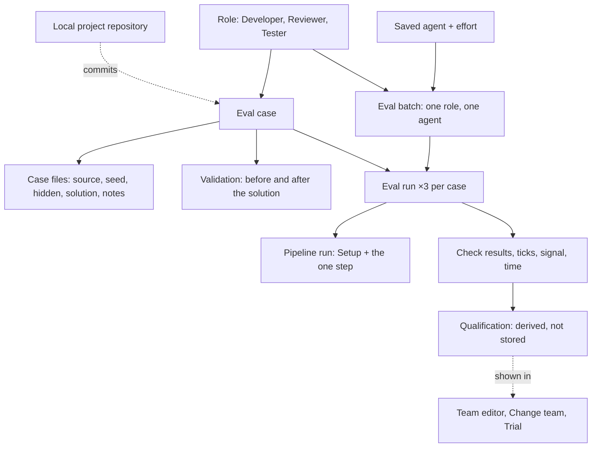
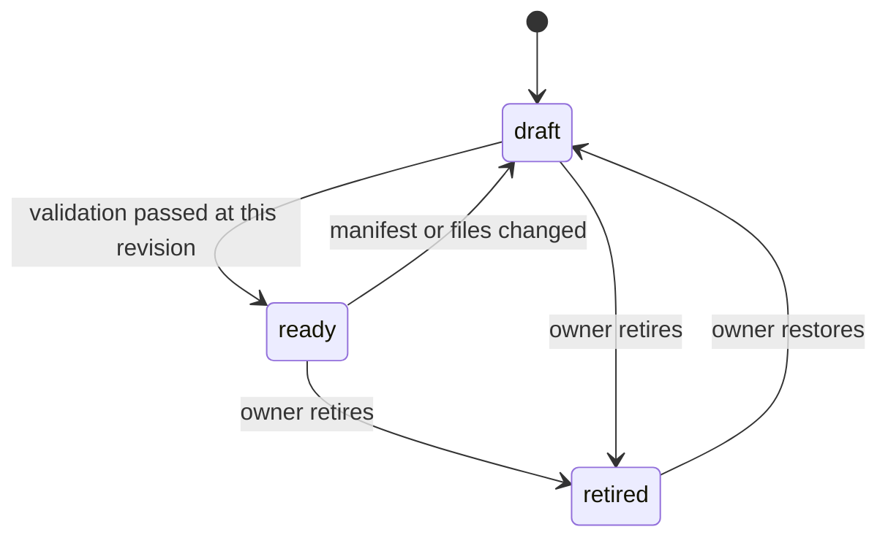
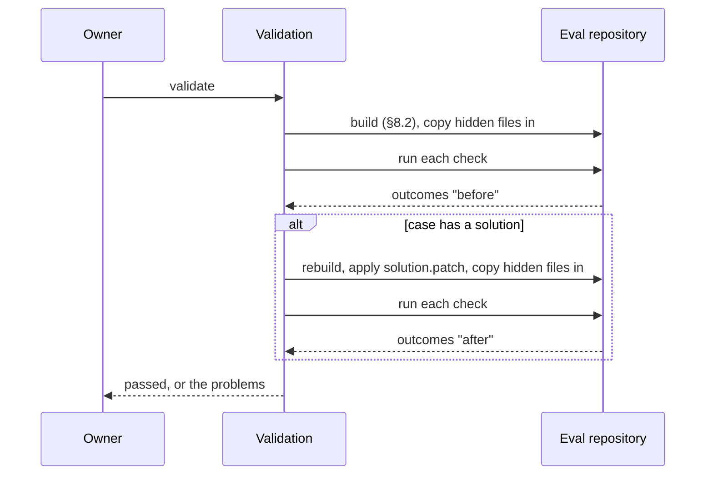
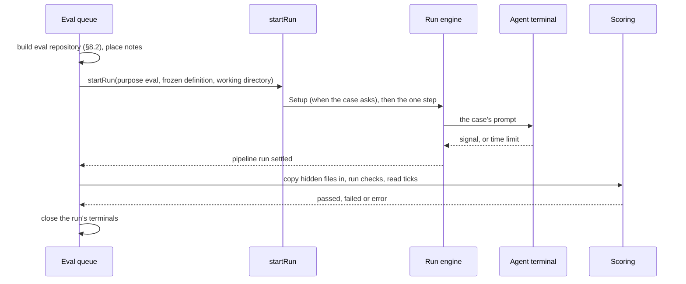

# Role Evals — Feature Specification

**Version:** 1.0
**Date:** 2026-11-28
**Status:** Draft

## 1. Overview

A workflow step is done by a saved agent (a CLI, a model and an effort) that a team gives to a
role. Today the owner chooses that agent by judgement. The analysis of one long run
(2026-11-28) shows why judgement is not enough: a small, fast model on Develop took 6 to 60
minutes a round and needed five repair rounds in nine, while two other runs with other
Develop agents took 4 to 13 minutes a round. Those runs built different phases, so the
comparison proves nothing. There is no measure.

A **role eval** is that measure. Each role has a few **eval cases**. A case is one step of
real work with a known answer: a snapshot of a repository at a commit, the prompt the step
was given, and checks that a machine can run afterwards. To evaluate an agent for a role,
CodeDeck runs every case of the role three times with that agent, through the same run
engine and terminals a workflow run uses, and scores each run with the case's checks. The
result says whether the agent **qualifies** for the role and how long it took.

The result is advice. An agent that has not been evaluated, or that failed, can still be
given the role; CodeDeck says so where the agent is chosen.

### 1.1 Relation to the Improvement Loop

The Improvement Loop (`2026-11-21-234207-improvement-loop-spec.md`) tests a role change by
replaying five whole past runs with the candidate agent and comparing each pair. It needs
five settled baseline runs and many hours of agent time. Role evals are the quick check
before that:

| | Role eval | Improvement Loop trial |
|---|---|---|
| Unit | One step on a fixed case | Five whole runs |
| Answer | Known in advance (checks) | Compared with the champion's delivery |
| Needs | Cases for the role | Five baseline runs of the champion |
| Time | Minutes per run | Hours |
| Says | The agent can do the role | The change is better than what is in use |

Neither blocks the other. A trial's screen shows the candidate agent's eval result for the
role (§8.11).

### 1.2 In scope

- Eval cases for step roles, built from commits of a local project's repository.
- A validation that proves a case is sound before any agent runs it.
- Eval runs through the run engine, scored by the case's checks.
- Batches: every ready case of a role, three runs each, for one agent and effort.
- A derived qualification per role, agent and effort, with its time.
- Showing the qualification where an agent is given a role.
- Evaluating an agent from the Agents tab, for several roles at once, when it is added or
  changed, with a notice when the evaluation finishes.
- Pre-filling a new case from a step of a finished run.

### 1.3 Out of scope

- Blocking an assignment. Qualification never refuses anything.
- Judging by a model. Every score comes from a command's exit status, a tick in a file or
  a signal. No reviewer call is made.
- Setup, Commit and read-only question steps (Clarify, Requirements, Brainstorm). Version 1
  supports the kinds in §5.1 only.
- Writing cases automatically. The owner supplies the commits, paths and checks.
- Sharing cases. A case holds a snapshot of a private repository and is never part of a
  workflow package or an export.
- Remote projects and the phone.

## 2. Domain hierarchy



## 3. Feature toggle

None. The feature does nothing until the owner creates a case.

## 4. Entities

Every field of every row read from SQLite, and every field of every request body, has its
own guard that throws naming the field and the row or request id (never file contents).

### 4.1 Eval case (`eval_cases`)

| Field | Type | Constraints | Default |
|-------|------|-------------|---------|
| `id` | TEXT | UUID v4, primary key | generated |
| `name` | TEXT | 1–80 characters, unique per role (case-insensitive) | — |
| `role` | TEXT | name of an existing role, 1–32 characters | — |
| `kind` | TEXT | §5.1 | — |
| `project` | TEXT | name of a local project at creation; kept if the project is later removed | — |
| `repository` | TEXT | name of the project's repository the case was cut from | — |
| `state` | TEXT | §5.2 | `draft` |
| `revision` | INTEGER | ≥ 1; +1 on every change to `manifest` or the case files | 1 |
| `manifest` | TEXT | JSON, §4.2 | — |
| `validation` | TEXT | JSON, §7.3, or null when never validated at this revision | null |
| `created_at`, `updated_at` | TEXT | ISO 8601 UTC | now |

### 4.2 Case manifest (JSON)

| Field | Type | Constraints |
|-------|------|-------------|
| `sourceCommit` | string | 40 hex characters; the commit the snapshot was taken from |
| `seed` | object or null | `{ from, to }` (commits) or `{ patch: true }`; the change applied on top of the snapshot before the step |
| `seedCommitted` | boolean | whether the seed is committed in the eval repository or left uncommitted |
| `prompt` | string | 1–20 000 characters; the step's prompt, frozen, with the input already in it |
| `readOnly` | boolean | as on a workflow step |
| `progressFile` | string or null | a path inside the repository, as a workflow's Progress file |
| `notes` | array | 0–8 of `{ name, bytes }`; earlier steps' notes placed in the run notes folder |
| `setup` | boolean | whether a Setup step runs first |
| `checks` | array | 1–40 checks, §4.3 |
| `ticks` | array | 0–40 of `{ task, expect }`; `task` is the exact text of a task line after its box, `expect` is `ticked` or `unticked` |
| `signal` | string or null | `COMPLETE` or `CONTINUE`: the signal the step must end with, or null for either |
| `hiddenPaths` | array | 0–200 repository paths copied in only for scoring |
| `referenceSec` | integer | 1–86 400; how long the step took where the case came from |
| `timeLimitSec` | integer | 60–86 400; a run that is still working after this fails |

### 4.3 Check

| Field | Type | Constraints |
|-------|------|-------------|
| `id` | string | 1–40 characters of `A-Z a-z 0-9 - _`, unique in the case |
| `label` | string | 1–120 characters |
| `command` | string | 1–2 000 characters; run with `sh -c` in the eval repository |
| `patch` | boolean | when true, the check's own patch file is applied before the command and reversed after it |
| `expect` | string | `pass` (exit 0) or `fail` (exit not 0) |
| `before` | string | `pass` or `fail`: the outcome on the case before any agent worked (§8.3) |
| `required` | boolean | a run passes only when every required check meets `expect` |
| `timeoutSec` | integer | 5–3 600 |

A check with `patch: true` and `expect: fail` is how a case asks "does the test the agent
wrote fail when the behaviour is broken?".

### 4.4 Case files

Under `~/.codedeck/evals/cases/<caseId>/`, never inside a repository:

| File | Content |
|------|---------|
| `source.tar` | `git archive` of `sourceCommit` |
| `seed.patch` | the seed, when there is one |
| `solution.patch` | a reference answer, when the case has one (§8.3) |
| `hidden/` | the files of `hiddenPaths`, at their repository paths |
| `checks/<checkId>.patch` | the patch of a check with `patch: true` |
| `notes/<name>` | the notes of `manifest.notes` |

Each file is at most 64 MiB, each patch at most 4 MiB, each note at most 256 KiB. The
manifest is the list of what must exist: a missing or extra file makes the case unreadable
and is reported with its name.

### 4.5 Eval batch (`eval_batches`)

| Field | Type | Constraints | Default |
|-------|------|-------------|---------|
| `id` | TEXT | UUID v4, primary key | generated |
| `role` | TEXT | role name | — |
| `agent_id` | TEXT | saved agent id | — |
| `agent_revision` | INTEGER | the agent's revision when the batch was created | — |
| `profile` | TEXT | JSON `{ provider, model, effort }`, each a string or null | — |
| `cases` | TEXT | JSON array of `{ caseId, revision }`, the ready cases of the role when created | — |
| `runs_per_case` | INTEGER | 3 | 3 |
| `state` | TEXT | §5.3 | `queued` |
| `created_at`, `finished_at` | TEXT | ISO 8601 UTC; `finished_at` null until done | now, null |

### 4.6 Eval run (`eval_runs`)

| Field | Type | Constraints | Default |
|-------|------|-------------|---------|
| `id` | TEXT | UUID v4, primary key | generated |
| `batch_id` | TEXT | references `eval_batches(id)`, cascade on delete | — |
| `case_id`, `case_revision` | TEXT, INTEGER | the case as it was when the batch was created | — |
| `ordinal` | INTEGER | 1–3 within the case | — |
| `retry_of` | TEXT | null, or the id of the run this one repeats after an error | null |
| `state` | TEXT | §5.4 | `queued` |
| `reason` | TEXT | §5.5, null while `queued`, `running`, `scoring` or `passed` | null |
| `pipeline_run_id` | TEXT | the pipeline run that did the work, null until started | null |
| `active_ms` | INTEGER | the step's active time, null until the step ends | null |
| `results` | TEXT | JSON, §7.5, null until scored | null |
| `started_at`, `finished_at` | TEXT | ISO 8601 UTC or null | null |

### 4.7 Pipeline run

`pipeline_runs` gains `purpose` TEXT NOT NULL DEFAULT `'work'`, one of `work` or `eval`.

## 5. Enums

### 5.1 Case kind

| Value | The step under test | What the checks usually prove |
|-------|--------------------|--------------------------------|
| `developer` | Builds a phase or a repair | Hidden acceptance tests pass; guard tests still pass |
| `reviewer` | Reviews a seeded change and fixes defects | A hidden test per seeded defect passes; guard tests still pass |
| `tester` | Tests a built phase | Ticks are as expected; a test it wrote fails on a broken build |

### 5.2 Case state



Only a `ready` case is part of a batch.

### 5.3 Batch state

`queued`, `running`, `done`, `cancelled`.

### 5.4 Eval run state

`queued`, `running`, `scoring`, `passed`, `failed`, `error`, `cancelled`.

`failed` is the agent's result. `error` is not: the case could not be run or scored.

### 5.5 Eval run reason

| Value | State | Meaning |
|-------|-------|---------|
| `check_failed` | failed | a required check did not meet `expect` |
| `tick_mismatch` | failed | a task's box is not as `ticks` expects |
| `signal_mismatch` | failed | the step ended with the other signal |
| `time_limit` | failed | still working at `timeLimitSec` |
| `asked_owner` | failed | the step used NEEDS_INPUT |
| `agent_failed` | failed | the pipeline run ended `failed` after the agent took the prompt |
| `setup_failed` | error | the Setup step did not complete |
| `agent_dialog` | error | the CLI showed a trust, permission or sign-in dialog |
| `agent_unavailable` | error | the agent never took the prompt, or its provider refused for quota |
| `case_unreadable` | error | a case file is missing, extra or over its limit |
| `scoring_failed` | error | hidden files or a check patch could not be applied |
| `interrupted` | error | the backend restarted during the run |
| `cancelled` | cancelled | the owner cancelled the batch |

### 5.6 Qualification

| Value | Meaning |
|-------|---------|
| `qualified` | every case of the batch passed |
| `failed` | at least one case failed |
| `incomplete` | no case failed, at least one has no result |
| `evaluating` | a batch for this agent, effort and role is queued or running |
| `stale` | the last finished batch was for another agent revision or another set of case revisions |
| `not_evaluated` | no finished batch |
| `too_few_cases` | the role has fewer than three ready cases |

## 6. API Endpoints

All under `/api/evals`. Errors are RFC 9457 problem details with `timestamp`, `status`,
`error`, `message`, `path` and `traceId`, an `X-Trace-Id` header, and an `errors` array
naming every failed field on 400. Lists take zero-based `page` (default 0) and `size`
(default 20, maximum 100) and return `{ data, page }`. Every sort ends with `id` as the
tiebreaker.

| Method | Path | Action | Status |
|--------|------|--------|--------|
| GET | `/cases` | List cases. Filters `role`, `project`, `state`, `kind`. Sort `-updatedAt` (default) or `name` | 200 |
| POST | `/cases` | Create a draft case and build its files from commits (§7.1) | 201, 400, 404, 409, 422 |
| GET | `/cases/:id` | One case with manifest, file sizes and validation | 200, 404 |
| PUT | `/cases/:id` | Replace the manifest and rebuild named files; `revision` must match | 200, 400, 404, 409, 422 |
| PUT | `/cases/:id/state` | `{ state: 'retired' | 'draft', revision }` | 200, 400, 404, 409 |
| DELETE | `/cases/:id` | Delete a case with no eval runs, and its files | 204, 404, 409 |
| POST | `/cases/:id/validations` | Validate the case (§8.3) | 200, 404, 409 |
| POST | `/case-drafts` | `{ runId, stepIndex, attempt }` → pre-filled case fields, nothing stored (§8.10) | 200, 400, 404, 409 |
| GET | `/batches` | List batches. Filters `role`, `agentId`, `state`. Sort `-createdAt` | 200 |
| POST | `/batches` | `{ agentId, effort, roles }` → start an evaluation for 1–8 roles, one batch per role, all or none (§8.5, §7.7) | 201, 400, 404, 409 |
| GET | `/batches/:id` | One batch with a per-case summary | 200, 404 |
| POST | `/batches/:id/cancellation` | Cancel what has not finished | 200, 404, 409 |
| GET | `/runs` | List eval runs. Filters `batchId`, `caseId`, `state`. Sort `-createdAt` or `ordinal` | 200 |
| GET | `/runs/:id` | One eval run with its results | 200, 404 |
| GET | `/qualifications` | List one row per role, agent and effort. Filters `role`, `agentId`. Sort `role` then agent name | 200 |

422 is a Git refusal while building files: an unknown commit, a path the commit does not
have, a patch that does not apply to the snapshot.

## 7. Request/Response Schemas

### 7.1 Create a case

```json
{
  "name": "Accounts page phase",
  "role": "Developer",
  "kind": "developer",
  "project": "shop",
  "repository": "api",
  "sourceCommit": "169369f0c1d2e3f4a5b6c7d8e9f0a1b2c3d4e5f6",
  "seed": null,
  "seedCommitted": false,
  "solution": { "from": "169369f0c1d2e3f4a5b6c7d8e9f0a1b2c3d4e5f6", "to": "2b27a1b0c1d2e3f4a5b6c7d8e9f0a1b2c3d4e5f6" },
  "hidden": { "commit": "2b27a1b0c1d2e3f4a5b6c7d8e9f0a1b2c3d4e5f6", "paths": ["frontend/tests/accounts-page.spec.ts"] },
  "prompt": "Read the todo file docs/todos/accounts.md, …",
  "readOnly": false,
  "progressFile": "docs/todos/accounts.md",
  "notes": [],
  "setup": true,
  "checks": [
    { "id": "accounts-browser", "label": "Account lifecycle at both viewports", "command": "cd frontend && npx playwright test tests/accounts-page.spec.ts --workers=1", "patch": false, "expect": "pass", "before": "fail", "required": true, "timeoutSec": 600 }
  ],
  "checkPatches": {},
  "ticks": [],
  "signal": null,
  "referenceSec": 1390,
  "timeLimitSec": 2780
}
```

`seed` and `solution` are `null`, `{ "from": "<commit>", "to": "<commit>" }` or
`{ "patch": "<unified diff text>" }`. `checkPatches` maps a check id to patch text for each
check with `patch: true`. `notes` entries are `{ "name": "01-develop.md", "content": "…" }`.

### 7.2 Case

```json
{
  "id": "…", "name": "Accounts page phase", "role": "Developer", "kind": "developer",
  "project": "shop", "repository": "api", "state": "ready", "revision": 3,
  "manifest": { "…": "§4.2" },
  "files": [ { "name": "source.tar", "bytes": 18234880 }, { "name": "solution.patch", "bytes": 41220 } ],
  "validation": { "…": "§7.3" },
  "createdAt": "2026-11-28T10:02:11.000Z", "updatedAt": "2026-11-28T10:20:40.000Z"
}
```

### 7.3 Validation

```json
{
  "revision": 3,
  "at": "2026-11-28T10:20:40.000Z",
  "passed": true,
  "before": [ { "checkId": "accounts-browser", "expected": "fail", "observed": "fail", "exitCode": 1, "ms": 41200 } ],
  "after":  [ { "checkId": "accounts-browser", "expected": "pass", "observed": "pass", "exitCode": 0, "ms": 58800 } ],
  "problems": []
}
```

`after` is null when the case has no solution. `problems` lists, in words, each check whose
observed outcome is not the expected one.

### 7.4 Batch

```json
{
  "id": "…", "role": "Developer", "agentId": "…", "agentName": "Fast developer", "agentRevision": 4,
  "profile": { "provider": "codex", "model": "example-model", "effort": "medium" },
  "state": "running", "runsPerCase": 3, "estimatedSec": 12510,
  "cases": [
    { "caseId": "…", "name": "Accounts page phase", "revision": 3, "result": "passed", "passedRuns": 2, "failedRuns": 1, "errorRuns": 0, "medianActiveMs": 1012000 },
    { "caseId": "…", "name": "Late-response repair", "revision": 1, "result": "pending", "passedRuns": 0, "failedRuns": 0, "errorRuns": 0, "medianActiveMs": null }
  ],
  "createdAt": "…", "finishedAt": null
}
```

A case `result` is `passed`, `failed`, `incomplete` or `pending`.

### 7.5 Eval run

```json
{
  "id": "…", "batchId": "…", "caseId": "…", "caseRevision": 3, "ordinal": 2, "retryOf": null,
  "state": "failed", "reason": "check_failed", "pipelineRunId": "…", "activeMs": 1104000,
  "results": {
    "signal": "COMPLETE",
    "checks": [ { "checkId": "accounts-browser", "expected": "pass", "observed": "fail", "exitCode": 1, "ms": 60210, "timedOut": false, "tail": "…last 4 KiB of output…" } ],
    "ticks": []
  },
  "startedAt": "…", "finishedAt": "…"
}
```

### 7.6 Qualification

```json
{
  "role": "Developer", "agentId": "…", "agentName": "Fast developer", "effort": "medium",
  "qualification": "failed", "batchId": "…", "at": "…",
  "casesPassed": 2, "casesTotal": 3, "totalMedianActiveMs": 2890000,
  "readyCases": 3, "estimatedSec": 12510, "canEvaluate": true, "cannotEvaluateReason": null
}
```

`totalMedianActiveMs` is the sum, over the passed cases, of each case's median active time
among its passed runs. `batchId` and `at` are null for `not_evaluated` and `too_few_cases`.
`readyCases` and `estimatedSec` describe the role as it is now: its ready cases, and the
agent time a new evaluation would take (§8.5). `canEvaluate` is false, with the reason in
words, when a batch for this role, agent and effort would be refused.

### 7.7 Start an evaluation

Request:

```json
{ "agentId": "…", "effort": "medium", "roles": ["Developer", "Reviewer", "Tester"] }
```

Response 201: `{ "data": [ Batch, Batch, Batch ] }`, one batch per role in the order given
(§7.4). `roles` holds 1–8 distinct role names. A 409 names every role that was refused and
why in its `errors` array, with `field` set to `roles[<index>]`; no batch is created.

## 8. Behavioral Rules

### 8.1 Building a case's files

- The case's project must be local and `repository` one of its repositories. The commits
  are read from that repository's checkout. Nothing in it is changed.
- `source.tar` is `git archive` of `sourceCommit`. A `{ from, to }` seed or solution is
  `git diff --binary from to`. Hidden files are read from `hidden.commit` at each path.
- Every commit and path is checked to exist before any file is written. A case is created
  with all its files or not at all.
- A solution may not touch a hidden path's absence: hidden files are copied in after the
  solution is applied (§8.3), and replace what is there.
- Changing a commit, a path, a patch, a note, the prompt, a check or a tick raises the
  revision, clears `validation` and returns the case to `draft`. Changing only the name does
  not.

### 8.2 The eval repository

Every validation and every eval run works in a new **eval repository**, a throw-away Git
repository at `~/.codedeck/evals/work/<id>/repo`:

1. `git init`, extract `source.tar`, commit everything as one commit.
2. Apply `seed.patch` when there is one; commit it when `seedCommitted`, otherwise leave it
   uncommitted.

The eval repository has no remote and no history beyond these commits, so the answer cannot
be found in a later commit. The project's own repository is never the working directory of
an eval run.

### 8.3 Validation

Validation proves a case can tell a right answer from no answer. It uses no agent.



- **Before:** every check's observed outcome must equal its `before`.
- **After** (when there is a solution): every check's observed outcome must equal its
  `expect`.
- At least one required check must have `before` different from `expect`; otherwise the case
  cannot fail and validation reports it.
- A `developer` or `reviewer` case must have a solution. A `tester` case may have none.
- Checks run one at a time, in order, each with its `timeoutSec`; a timeout is the outcome
  `fail` and is recorded as timed out.
- A validation that passes at the case's current revision makes the case `ready`. One that
  fails leaves it `draft` with the problems stored.
- A project that needs installed dependencies to run its checks is prepared by the case's
  own first checks (for example an install command as a non-required check with
  `before: pass`, `expect: pass`). Validation runs no Setup agent.

### 8.4 An eval run



- The pipeline run has `purpose: eval`, no task, the case's project, and a frozen
  definition of at most two steps: Setup with the Setup agent chosen in Settings (when
  `manifest.setup`), then one step named after the role, with the case's prompt, `readOnly`
  and Progress file, the batch's agent and effort, repeat `once`, no approval, and
  `agentsDecide: true`.
- Setup's home checkout is the project's repository, as for a task; its working directory
  is the eval repository.
- The case's notes are written to the run notes folder before the step starts, under their
  names.
- The step is told, through the step guidance, that the run is a measurement and that it
  must not push, open a pull request or a merge request, deploy, or change anything outside
  the eval repository.
- Active time is the step's own, as the task view counts it. Setup is not counted.
- At `timeLimitSec` of active time the pipeline run is stopped and the eval run is `failed`
  with `time_limit`. It is still scored, so the owner sees how far it got.
- NEEDS_INPUT ends the eval run `failed` with `asked_owner`. CodeDeck does not answer for
  the agent in an eval run.
- A CLI dialog, an agent that never takes the prompt, a quota refusal, a failed Setup, and a
  backend restart end the eval run in `error` with the reason of §5.5.
- **Scoring:** hidden files are copied in, replacing what is there. Checks run as in §8.3.
  A check with `patch: true` has its patch applied before the command and reversed after;
  a patch that does not apply is the outcome `fail` for an `expect: fail` check and
  `scoring_failed` for an `expect: pass` check. Ticks are read from the Progress file by
  exact task text; a task that is not found is a mismatch.
- **A run passes** when the step ended with an accepted signal within the time limit, that
  signal is `manifest.signal` or `signal` is null, every required check met `expect`, and
  every tick is as expected. Otherwise it fails with the first reason that applies, in the
  order `time_limit`, `asked_owner`, `agent_failed`, `signal_mismatch`, `check_failed`,
  `tick_mismatch`.
- When scoring ends, the run's terminals are closed. The eval repository is kept until the
  batch is deleted or a later batch for the same role, agent and effort finishes.

### 8.5 Batches and the queue

- An evaluation is started for one agent, one effort and one or more roles. It creates one
  batch per role, in the order the roles were given, in one transaction: when any role is
  refused, none is created.
- A batch takes the role's `ready` cases as they are at that moment and creates three
  queued eval runs per case. Fewer than three ready cases refuses the batch with 409.
- The agent must be a saved preset agent; an agent with a custom launch command is refused
  with 409, because its provider and model are not known. `effort` is one the agent's
  provider offers, or null for the CLI's default.
- A second batch for the same role, agent and effort while one is queued or running is
  refused with 409.
- `estimatedSec` is the sum of `referenceSec` over the cases, times three.
- **One eval run works at a time**, across all batches, oldest batch first, and within a
  batch case by case in the order of the batch's `cases`. An eval run does not start while a
  replay of an Improvement Loop trial is working, and a replay does not start while an eval
  run is working. Workflow runs the owner starts are not held back.
- **Early stop:** when two runs of a case have passed, or two have failed, its third run is
  `cancelled` with reason `cancelled` and not started. The case result is already decided.
- **Retry:** a run that ends in `error` is repeated once, as a new eval run with `retry_of`.
  A second error leaves that slot without a result.
- Cancelling a batch stops the working pipeline run, sets every unfinished eval run to
  `cancelled`, and sets the batch to `cancelled`. Finished results are kept.
- At backend start, an eval run in `running` or `scoring` becomes `error` with
  `interrupted` and is retried under the rule above; the queue then continues.

### 8.6 Case result and qualification

Nothing here is stored; it is computed from the batch's runs by a pure function.

- A case **passed** when at least two of its runs passed; **failed** when at least two
  failed; **incomplete** when the batch is `done` or `cancelled` and neither holds;
  **pending** otherwise.
- For a role, agent and effort, take the latest batch that is `done`:
  - none → `not_evaluated`;
  - its `agent_revision` differs from the agent's current revision, or its `cases` differ
    from the role's current ready cases and their revisions → `stale`;
  - any case failed → `failed`; else any case incomplete → `incomplete`; else `qualified`.
- A queued or running batch for the same key makes the answer `evaluating`, whatever the
  earlier result.
- A role with fewer than three ready cases answers `too_few_cases` for every agent.
- The list of qualifications has one row for every pair of a role that has at least one
  case and a saved agent, at the effort of each finished or working batch, and at the
  CLI's default effort when there is none. An agent with a custom launch command has rows
  too, always `not_evaluated` with `canEvaluate` false, so that the reason can be shown.

### 8.7 Time

Time never decides a result except through `timeLimitSec`. It is reported: per run, per
case (median of the passed runs), and per role (sum of the case medians). The Evals tab
sorts agents of a role by that sum so that, among agents that qualify, the fastest is
first.

### 8.8 Privacy and files

- Case files and eval repositories are under `~/.codedeck/evals/` only. No case content is
  written to the database except the manifest.
- A workflow package, a workflow export and the Project Assistant's tools never include a
  case, a case file or an eval run.
- Check commands are the owner's own, like an agent's launch command, and are run as
  written. They are never built from a request field other than `command`.
- Deleting a case deletes its folder. Deleting a batch deletes its eval repositories.

### 8.9 Runs with purpose `eval`

A pipeline run with `purpose: eval` is left out of: a project's run list and task strip,
the sidebar counts, the Changes list, Improvement Loop observations and signals, team
scoring and attribution, and phone pushes. It is reachable only from its eval run on the
Evals tab, which opens its terminal and notes read-only.

### 8.10 Pre-filling a case from a run step

`POST /case-drafts` takes a finished run's step attempt and returns fields for the create
form. It stores nothing.

| Field | Pre-filled from |
|-------|-----------------|
| `role`, `kind` | the step's role: Developer → `developer`, Reviewer → `reviewer`, Tester → `tester`; another role is refused with 409 |
| `project`, `repository` | the run's project and the repository its working directory belongs to |
| `prompt` | the step's prompt from the run's frozen definition, with the run's input in it |
| `readOnly`, `progressFile` | the step and the run's frozen definition |
| `referenceSec` | that attempt's active time, rounded up to a second |
| `timeLimitSec` | twice `referenceSec`, at least 600 |
| `sourceCommit` | the run's base commit |
| `notes` | the stored notes of the earlier steps of the same round |
| `setup` | true |

The owner supplies the rest: the right source commit when the step was not the run's first,
the seed, the solution, the hidden paths, the checks and the ticks.

### 8.11 Where the qualification is shown

- **Settings → Workflows → Evals** (a new sub-tab): per role, its cases with state and last
  validation; a table of agents with qualification, cases passed, total time and the date;
  **Evaluate** per agent with an effort chooser, showing the estimated agent time before it
  starts; a working batch with its runs, each opening its results, terminal and notes.
- **Team editor:** beside each role's agent and fallback, the qualification for that role
  at the chosen effort, in words ("Qualified · 48m", "Failed 1 of 3", "Not evaluated",
  "Evaluating", "Out of date", "Too few cases"). Nothing is disabled.
- **Change team** in a run: the same words beside each step's agent.
- **Improvement Loop trial** (`team_role` subject): one line with the candidate agent's
  qualification for the role, linking to the Evals tab.
- Every mutating action shows a toast for success and for failure, with the message from
  the response. The tab reads from the backend every two seconds while a batch is queued or
  running and holds no result of its own.

### 8.12 Evaluating from the Agents tab

The Evals tab is organised by role. The Agents tab is where an agent is added, so the same
actions are offered there, organised by agent.

- **Each agent** in Settings → Agents shows one short line per role that has cases:
  the role and the qualification in the words of §8.11. An agent with a custom launch
  command shows "Cannot be evaluated: custom command" once, instead of a line per role.
  When no role has a case, the agent shows nothing about evals.
- **Evaluate…** on an agent opens a dialog: the effort (the agent's provider's efforts and
  the CLI's default), and the roles as tick boxes. A role that cannot be evaluated is shown
  unticked and disabled with its reason ("Too few cases", "Already evaluating"). The roles
  that can be are ticked to begin with. The dialog shows the agent time of the ticked roles,
  the sum of their `estimatedSec`, and changes as boxes are ticked. **Start** sends one
  request (§7.7).
- **After a new agent is saved**, and after a saved agent is changed in a way that raises
  its revision, the Agents tab shows a notice on that agent: "Evaluate this agent for its
  roles?" with **Evaluate…** and **Not now**. It is shown only when at least one role can
  be evaluated. Nothing is started without **Start** in the dialog: an evaluation costs
  agent time and tokens. **Not now** hides the notice for that agent revision in this
  browser; the lines per role still say "Not evaluated" or "Out of date".
- **While an agent is being evaluated**, its lines read "Evaluating · 2 of 9 runs" and link
  to the batch on the Evals tab, where it can be followed and cancelled.
- **When a batch finishes**, wherever the owner is in CodeDeck, a toast names the agent, the
  role and the result: "Fast developer · Developer: qualified in 48m", "… failed 1 of 3",
  "… incomplete". A cancelled batch gives no toast. The app reads the working batches every
  five seconds while any is queued or running, and not at all otherwise. A batch that
  finishes while no CodeDeck window is open gives no toast; its result is on the Agents
  tab and the Evals tab when the app is next opened.
- The phone gets nothing (§1.3).

## 9. Acceptance Criteria

All are checked with fixture Git repositories made by the tests and scripted terminals in
place of agent CLIs.

- Creating a case from commits writes exactly the files its manifest names; an unknown
  commit, a missing path or a patch that does not apply returns 422 and leaves no case and
  no folder.
- Every field of the create body is validated, and a 400 names every failed field.
- A row of `eval_cases`, `eval_batches` or `eval_runs` with any one field invalid is refused
  on read with an error naming the field and the id.
- Validation of a sound case reports each check `before` and `after` and makes the case
  `ready`; a check whose outcome differs from `before` or from `expect`, a case where no
  required check can fail, and a `developer` case without a solution each leave it `draft`
  with the problem in words.
- Changing a check returns a ready case to `draft`, raises its revision and clears its
  validation; renaming it does not.
- An eval repository contains the snapshot commit and the seed, and no other commit.
- An eval run whose scripted agent applies the right change is `passed`; one that does not
  is `failed` with `check_failed`; one that signals the other signal, leaves a task ticked
  that should be unticked, asks the owner, or works past the time limit is `failed` with the
  matching reason.
- A check with `patch: true` and `expect: fail` passes only when the command fails with the
  patch applied, and the patch is reversed afterwards.
- A CLI dialog, a Setup failure and a backend restart during a run give `error` with the
  matching reason, and the run is repeated once.
- A batch creates three runs per ready case, works one run at a time, cancels a case's third
  run once two agree, and ends `done`.
- Starting an evaluation for three roles creates three batches in the order given; when one
  of the roles is refused, none is created and the 409 names that role by its index.
- A role with two ready cases refuses a batch with 409; an agent with a custom command is
  refused with 409; a second batch for the same key is refused with 409.
- Qualification is `qualified`, `failed`, `incomplete`, `evaluating`, `stale`,
  `not_evaluated` and `too_few_cases` in exactly the situations of §8.6, including `stale`
  after the agent's revision changes and after a case's revision changes.
- A pipeline run with `purpose: eval` appears in none of the places listed in §8.9.
- Every list endpoint returns the `data` and `page` envelope, applies its default and
  maximum size, refuses an unknown sort or filter field with 400, and orders ties by id.
- `POST /case-drafts` returns the fields of §8.10 for a Developer, a Reviewer and a Tester
  step and 409 for any other role.
- The Evals tab lists cases and agents, starts and cancels a batch with a toast for each
  outcome, and shows a run's check results; the team editor and Change team show the
  qualification in words and disable nothing.
- The Agents tab shows each agent's result per role, and the custom-command sentence for an
  agent that cannot be evaluated; **Evaluate…** ticks only the roles that can be evaluated,
  shows the summed agent time, and starts them with one request.
- Saving a new agent shows the notice once when a role can be evaluated and never starts an
  evaluation by itself; **Not now** hides it for that revision.
- A batch that finishes while the app is open gives one toast with the agent, role and
  result, whichever screen is shown; a cancelled batch gives none.

## 10. Assumptions

- ASSUMPTION: a case's prompt is frozen in the case. Reason: a case measures the agent, so
  everything else must stand still; a prompt change is tested by an Improvement Loop trial.
- ASSUMPTION: three runs per case and two-of-three to pass. Reason: one run of an agent is
  noise, and three is the least that gives a majority. The count is a column so a later
  change needs no migration of meaning.
- ASSUMPTION: a role needs three ready cases before any qualification is given. Reason: one
  or two cases say too little to label an agent.
- ASSUMPTION: time is reported and never decides a result except through the case's time
  limit, which defaults to twice the reference time. Reason: a correct slow agent and a
  wrong fast one must not get the same label, and the owner compares times among agents
  that qualify.
- ASSUMPTION: the snapshot is stored in the case as an archive instead of being read from
  the project at run time. Reason: the commit may be deleted with its branch, and a fresh
  repository without later history keeps the answer out of reach.
- ASSUMPTION: qualification is keyed by agent revision and effort, not by model name alone.
  Reason: the same model behind another CLI, or at another effort, behaves differently.
- ASSUMPTION: a run that errors is repeated once. Reason: a lost terminal or a quota refusal
  says nothing about the agent, and an endless retry would hide a broken case.
- ASSUMPTION: a new agent is offered an evaluation and never given one automatically.
  Reason: three roles of three cases are up to twenty-seven agent runs, which the owner
  must choose to spend.
- ASSUMPTION: no Setup agent in validation. Reason: validation must be repeatable and free.
- ASSUMPTION: no database schema file is produced. Reason: this project keeps none; its
  tables are created at startup in `server/db.js`, and §4 is the schema of the new ones.

## 11. First cases

Guidance for the owner, not work in this repository. Good cases come from the owner's own
finished runs, three per role:

| Role | Take | Why |
|------|------|-----|
| Developer | A phase that was accepted first time | The ordinary job: its delivered tests are the hidden checks |
| Developer | Two repairs whose first attempt was sent back | They separate an agent that reads the finding from one that does the least |
| Reviewer | Two phases as they stood before a review that fixed defects | Each fixed defect becomes a hidden test |
| Reviewer | A change with one weak assertion among sound ones | Measures attention, not volume |
| Tester | Two built phases whose tests did not assert what their tasks name | The gaps a careless tester lets through |
| Tester | A sound phase | The right answer is to reopen nothing; it measures false alarms |

The state before a review is rarely a commit. For a Reviewer case the seed is a patch that
puts the defects back.
